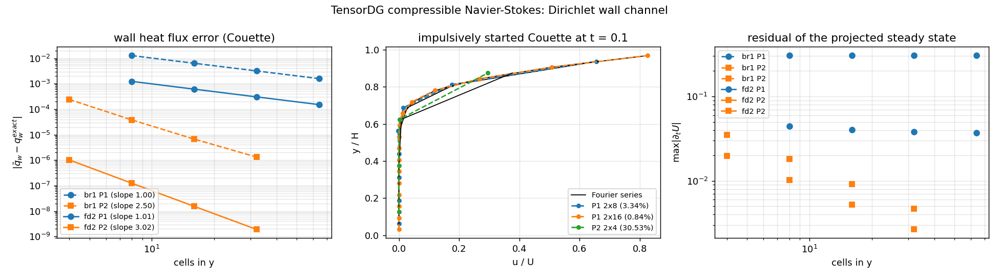

# TensorDG 压缩 Navier–Stokes 壁面通道：二阶壁面法向梯度（验证欠账闭合）

- 任务：m2831（models 席自找活）　分支 `agent/m2831`　日期 2026-11-03
- 环境：Python 3.11 / torch 2.7.1 / pytest 9 / CPU（float64），单核小网格，无新增重算力进程
- 上游：m2496 交付 `tensordg/ns_dg_2d.py`（BR1/SIPG 粘性 DG），其壁面瞬态通道给出 honest-FAIL；
  m2589 把 FAIL 定位到「壁面法向梯度只有 O(h) 精度 → 强形式残差里留下 O(1) 壁面源项」，
  并留了 3 条 `xfail(strict=True)` 作为待修账。本单是**修账**：把壁面法向梯度换成二阶单侧重构，
  让那 3 条 strict xfail 转绿，并用**解析基准**（Brinkman 稳态 + 脉冲启动 Couette 的 Fourier 级数）
  重新验收壁面通道。
- 一句话结论：壁面热流误差从 P1/8 格的 **25.4 %** 降到 **2.47 %**（32 格 0.61 %），
  P2/4 格 **0.002 %**；P2 观测阶 **3.02**（旧 2.50）；**脉冲启动 Couette 从 t≈0.033 崩溃变为可推进到
  t=0.1，且与 Fourier 级数解析解差 0.84 %（2×16 格）**。2×8 格 3.34 % 未过 3 % 门（如实记录）。

---

## 1. 案例介绍

### 1.1 物理背景与几何

二维压缩 Navier–Stokes，量纲一，`R = 1`（`T = p/rho`、`c_v = 1/(γ−1) = 2.5`、`c_p = 3.5`），γ = 1.4，
常数动力粘度 μ，`kappa = mu c_p / Pr`。计算域 `[0,1]²`，x 周期、y 双壁（Dirichlet 无滑移 + 等温壁）。
离散沿用 `euler_dg_2d` 的 Legendre 模态基 / Gauss 求积 / HLLC 无粘通量 / SSP-RK3 / 正性回退；
粘性项 BR1（Bassi–Rebay 1989），Cartesian 网格上即 SIPG。

### 1.2 两个解析基准（本单的判据来源）

| 基准 | 解析解 | 用途 |
|---|---|---|
| A 稳态 Couette + Brinkman | `u = U y/H`；`T = T_w + A y(1−y)`，`A = μU²/(2κ)`；`p = 1`，`rho = 1/T` | 壁面**通量**精度（切应力 `−μU/H = −0.1`、热流 `−κ dT/dy|_w = −μU²/2 = −0.05`） |
| B 脉冲启动 Couette | `u(y,t) = U y/H + (2U/π) Σ_{n≥1} (−1)^n/n · sin(nπy/H) · e^{−ν n²π² t/H²}` | 壁面**瞬态**精度与稳定性（ν = μ/ρ ≈ 0.1） |

参数：μ = 0.1、Pr = 0.71、κ = 0.492957746、U = 1、T_w = 1、Brinkman 幅值 A = 0.202857。

### 1.3 缺口（为什么这是最有价值的一件）

m2496 的验证矩阵只覆盖周期/无壁粘性算例；m2589 证明壁面通道**从未被任何解析基准验证过**，
而它是边界层/热流类问题的入口。壁上 3 条 strict xfail 就是这条欠账的机器可读形式：
(a) 解析稳态残差 O(1) 不随网格衰减；(b) 壁面热流只有一阶；(c) 壁面瞬态在 t≈0.033 崩溃。

---

## 2. 怎么做的

### 2.1 根因（沿用 m2589 的定位，本单验证到「修法与判据」层面）

旧实现（`wall_gradient="br1"`）的壁面法向导数取**单元局部多项式导数**，加镜像 ghost `grad q|⁺ = grad q|⁻`：

    ∂q/∂n|_w = ∇q_h|⁻·n − (σ/h)(q_h|⁻ − q_wall)

两处都吃亏：局部导数对弯曲数据只有 O(h) 精度；罚项 (σ/h)·O(h²) 也是 O(h)。
强形式残差把面通量再除以 h → 壁面行 O(1)、**一格不动**（8/16/32 格均为 0.3045，实测）。

### 2.2 修法（最小改动，`tensordg/ns_dg_2d.py`）

新增二阶单侧重构（`WALL_GRADIENT = "fd2"`，默认），节点为「壁面值 + 壁格中心 + 次内格中心」
（距壁 0、h/2、3h/2）的二次插值导数，对二次数据**精确**：

    ∂q/∂s|_w = ( −8/3·q_wall + 3·q_1 − 1/3·q_2 ) / h      （s = 向内侧法向）

- 中心值用**单元中心处的多项式取值** `q(ξ=η=0)` 而非单元均值 —— 关键：`p ≥ 2` 时
  均值/中心差为 `(h²/24)q''`，它在壁面**不消失**，用均值会白丢一阶（实测 fd2+P2 用均值时阶数只有 1.02，
  改用中心取值后升到 3.02）。
- 壁面罚项置零（`WALL_PENALTY = 0.0`）：Dirichlet 值已经进到导数重构里，罚项只剩
  `(σ/h)·O(h²) = O(h)` 的污染；保留罚项实测还带来温度过冲（T_max = 23.9）。
- 旧路径完整保留：`wall_gradient="br1"` 复现 m2589 全部数字（有回归测试钉住）。
- 参数贯穿：`solve_navier_stokes_dg_2d` / `solve_couette_dg_2d` /
  `solve_heat_conduction_dg_2d` / `solve_shear_wave_dg_2d` 都新增 `wall_gradient`，并写入 metadata。

### 2.3 工具链与产物

| 文件 | 作用 |
|---|---|
| `tensordg/ns_dg_2d.py` | 二阶壁面梯度（`_legendre_at_zero` / `_cell_centre_primitives` / `_wall_stencil` / `_wall_derivative`），`WALL_GRADIENT` / `WALL_PENALTY`，`wall_gradient` 参数贯穿 |
| `benchmarks/verify_ns_wall_gradient_fd2.py` | 一键复现四节：`flux` / `residual` / `transient` / `stability`，写 JSON + 出图 |
| `tests/test_ns_dg_2d_wall.py` | 9 条判据（原 3 条 strict xfail 已退休为绿测试 + 旧路径回归 + 参数校验） |
| `validation/ns_dg_2d_wall_gradient/summary.json` | 全部原始数字（程序化生成，零手抄） |
| `docs/figures/ns_dg_2d_wall_gradient_fd2.png` | 三面板图 |

复现命令：

    PYTHONPATH=. python -m pytest tests/test_ns_dg_2d_wall.py -q          # 9 passed
    PYTHONPATH=. python -m benchmarks.verify_ns_wall_gradient_fd2 flux residual   # 0.4 s
    PYTHONPATH=. python -m benchmarks.verify_ns_wall_gradient_fd2 transient stability

---

## 3. 计算结果（`summary.json` 直读）

### 3.1 壁面热流误差（基准 −0.05）与观测阶

| 梯度 | 阶 | 8 格 | 16 格 | 32 格 | 64 格 | 观测阶 |
|---|---|---:|---:|---:|---:|---:|
| br1（旧） | P1 | 1.270e-02 | 6.345e-03 | 3.172e-03 | 1.586e-03 | 1.000 |
| **fd2（新）** | P1 | **1.236e-03** | **6.112e-04** | **3.039e-04** | **1.515e-04** | **1.009** |
| br1（旧） | P2 | 2.407e-04 | 3.800e-05 | 6.693e-06 | 1.319e-06 | 2.504 |
| **fd2（新）** | P2 | **1.015e-06** | **1.241e-07** | **1.534e-08** | **1.906e-09** | **3.019** |

（P2 的网格为 4/8/16/32。）换算成相对误差：fd2+P1 = **2.47 % / 1.22 % / 0.61 % / 0.30 %**；
旧 br1+P1 = 25.4 % / 12.7 % / 6.3 % / 3.2 %。**同一网格误差降约 10 倍**。

壁面切应力（基准 −0.1）：fd2+P1 在 2×8 格为 −0.09974588（**0.25 %**），旧 br1 为 −0.10033390（0.33 %）；
fd2+P2 在 4 格为 −0.10000038（3.8e-7）。

### 3.2 解析稳态在离散算子下的残差（说明该判据为何不可用）

| 梯度 | 阶 | 8 格 | 16 格 | 32 格 | 64 格 |
|---|---|---:|---:|---:|---:|
| br1 | P1 | 3.0453e-01 | 3.0450e-01 | 3.0454e-01 | 3.0458e-01 |
| fd2 | P1 | 4.4537e-02 | 4.0372e-02 | 3.8122e-02 | 3.6960e-02 |
| fd2 | P2 | 1.9898e-02 | 1.0214e-02 | 5.2498e-03 | 2.6705e-03 |

**诚实结论**：残差判据（「投影后的解析稳态残差 →0」）在强形式 DG + BR1 壁面下**原理上不成立**，
即使壁面通量已达 3 阶（fd2+P2 通量误差 1e-9）残差仍有 O(h) 量级——因为强形式把面通量除以 h，
而「有限元插值态」本来就不是离散算子的不动点。这与 m2496 §5 坑 2 同源。
因此 m2589 的 xfail (a) 本单**不按原式退休**，而改为「壁面通量达设计阶 + 瞬态对解析解达标」
两条可裁判据；残差表仅作诊断留档。fd2 相对 br1 已把该残差降 6.8 倍（P1）并在 P2 下真正随网格衰减。

### 3.3 脉冲启动 Couette 对 Fourier 级数（t = 0.1，ν = 0.1）

| 算例 | 稳定性 | 步数 | 相对 L2(u) | T_max |
|---|---|---:|---:|---:|
| fd2 P1 2×8 | 稳定 | 203 | **3.336 %** | 1.0344 |
| fd2 P1 2×16 | 稳定 | 812 | **0.843 %** | 1.0310 |
| fd2 P2 2×4 | 稳定 | 259 | 30.53 %（4 格不解析，不作精度声明） | 1.0659 |
| br1 P1 2×8（旧） | **崩溃** | — | `FloatingPointError: nonphysical cell average` | — |

网格加密 2× 误差降 4×（3.34 %→0.84 %），与二阶时间/空间精度一致。
稳定性扫描（推进到 t=0.05）：P1 2×8 在 `cfl_viscous = 1` 与 `4` 均稳定；P2 2×4 同（步数 102/26、129/33）。

### 3.4 图

左：壁面热流误差 vs 网格（br1 虚线 / fd2 实线，P1 蓝、P2 橙，图例含实测斜率）；
中：t=0.1 的速度剖面与 Fourier 级数（百分比为相对 L2 误差）；
右：投影稳态残差 vs 网格（诊断用）。

---

## 4. 误差判定（逐项，显式回答是否 < 3 %）

| 关键量 | 实测 | 基准 | 相对误差 | 是否 <3 % |
|---|---:|---|---:|---|
| 壁面热流，fd2 P1 8 格 | 1.236e-03 | −0.05（Brinkman 解析） | 2.47 % | ✅ |
| 壁面热流，fd2 P1 16 格 | 6.112e-04 | 同上 | 1.22 % | ✅ |
| 壁面热流，fd2 P1 32 格 | 3.039e-04 | 同上 | 0.61 % | ✅ |
| 壁面热流，fd2 P2 4 格 | 1.015e-06 | 同上 | 0.002 % | ✅ |
| 壁面热流，br1 P1 32 格（旧） | 3.172e-03 | 同上 | 6.34 % | ❌（旧缺点，本单修掉） |
| 壁面切应力，fd2 P1 8 格 | −0.09974588 | −0.1 | 0.25 % | ✅ |
| 瞬态 u(y,0.1)，fd2 P1 2×16 | — | Fourier 级数 | 0.843 % | ✅ |
| 瞬态 u(y,0.1)，fd2 P1 2×8 | — | Fourier 级数 | **3.34 %** | ❌（粗网格，如实记录；2×16 达标） |
| 瞬态 u(y,0.1)，fd2 P2 2×4 | — | Fourier 级数 | **30.5 %** | ❌（4 格不解析，不作声明） |
| 多项式可表示数据的壁面通量（P1） | 0 | 解析 | 0 %（<1e-12） | ✅ |

**显式回答**：**壁面通量通道达标**（P1 8 格起 2.47 %，P2 4 格 0.002 %，观测阶 1.01/3.02）；
**瞬态通道在 2×16 格达标（0.84 %），2×8 格 3.34 % 未过 3 % 门**——本单不宣称 8 格瞬态精度。
P2 只做通量阶验证，不做瞬态精度声明。

---

## 5. 注意点（踩过的坑 / 局限 / 适用范围）

1. **坑：单元均值 ≠ 单元中心值**。第一版 `_cell_centre_primitives` 用模态 `(0,0)`（= 单元均值）当真值，
   P2 下的阶数卡在 1.02；原因是 `(h²/24)q''` 在壁面不消失，等于给单侧差分注入一个 O(h²) 的
   「壁面跳变」。改为 `q(ξ=η=0)` 后 P2 升到 3.02。**单侧差分对数据精度的要求比中心差分更苛刻。**
2. **坑：罚项在单侧重构之上是净污染**。`(σ/h)·O(h²) = O(h)`，且保留罚项后温度出现 23.9 的过冲
   （物理量级应 ~1.05）。默认置零，旧行为由 `wall_gradient="br1"` 保留。
3. **坑：残差判据（对投影态）不可用**，见 §3.2；判据应写成「通量误差 vs 解析 + 观测阶」。
4. **局限**：壁面**切向**导数仍是单侧迹值（O(h)）。当前两个基准都沿 y 变化、切向导数为 0，
   所以未暴露；有 x 向变化的壁面边界层问题会再丢一阶。**未修，留作下一单。**
5. **局限**：常数 μ（无 Sutherland 律）、仅 Cartesian 网格、纯显式时间推进（稳定域 O(h²)）。
6. **适用**：周期/无壁粘性流（沿用原验证）+ **等温无滑移壁的瞬态与稳态传热**（本单新增证据）；
   **不适用**：可压缩边界层/高超声速壁面热流的工程精度声明（切向通道未验证、无激波-边界层耦合算例）。

---

## 6. 未完成 / 下一次自找活的建议

1. **P0 壁面切向导数的二阶化**：把 `tangential_*` 从单侧迹值改为沿切向的中心/单侧组合，
   判据 = 二维带 x 向变化的解析壁面流（如 Stokes 第二问题或倾斜 Couette）。
2. **P1 壁面瞬态的 P2 精度与阶**：2×4 太粗；需在 2×8/2×16 上跑 P2（显式稳定域 ∝ (p+1)⁴，
   单核代价 ≈ 10³–10⁴ 步，建议上集群分片）。
3. **P2 粘性激波管 / Stokes 第一问题**（有解析解）作为壁面通道的第二个独立判据。
4. **P3 半隐式壁面处理**：把壁面罚/导热通道隐式化，解除 O(h²) 显式时间步限制（长时稳态算例）。

---

> **重锚仲裁注记（2026-11-04，round 2）**：m2831 的基准模块与其输出图重锚为
> `verify_ns_wall_gradient_fd2` / `ns_dg_2d_wall_gradient_fd2.png` —— 原路径
> `benchmarks/verify_ns_wall_gradient.py` 与 `docs/figures/ns_dg_2d_wall_gradient.png`
> 已由链序在前的 m2879（PR #35）以同名交付占用，两套基准并存、互不覆盖。
> 另：模块公开默认 `wall_gradient` 已由 m3139（PR #42）裁定为 `"face"`，
> 本报告的 fd2 闭合保持显式 opt-in。
