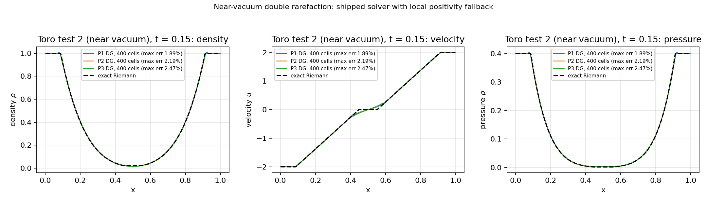
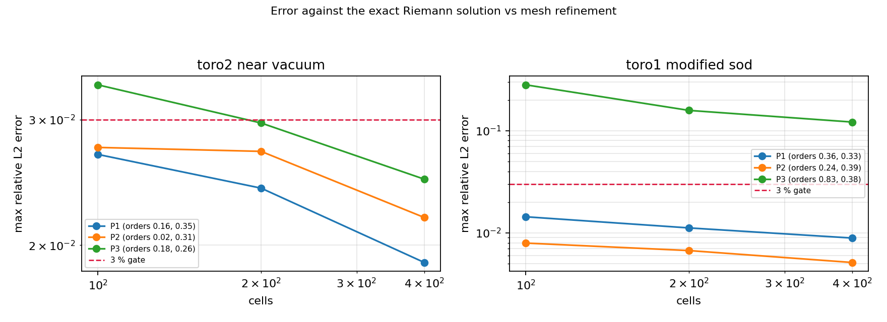

# 近真空双稀疏波（Toro test 2 / Einfeldt 123）：正性回退的验证欠账清算

> 类型：**验证欠账**（对已合并的 `tensordg/euler_dg_1d.py` 正性回退声明做解析基准复核）
> 工件：`validation/riemann_vacuum/vacuum_sweep.json`、`docs/figures/riemann_vacuum_profiles.png`、`docs/figures/riemann_vacuum_convergence.png`
> 复现：`python -m benchmarks.riemann_vacuum_1d && python -m benchmarks.report_riemann_vacuum`（本文与图全部由工件程序化生成，零手抄）

## 0. 结论摘要

| 判据 | 含义 | 结果 |
|---|---|---|
| `C1_admissibility_with_fallback` | 开启回退后全程 ρ>0、p>0、无 NaN、无中止（两案例） | PASS |
| `C2_near_vacuum_finest_mesh_error_below_3pct` | 近真空案例最细网格对精确解三场相对 L2 < 3% | PASS |
| `C2b_control_finest_mesh_error_below_3pct` | 对照算例最细网格同口径 < 3%（**P3 无限制器 Gibbs 越界，如实记 FAIL**） | FAIL |
| `C3_near_vacuum_fallback_disabled_aborts` | 近真空案例关闭回退后中止（证明回退承重） | PASS |
| `C4_fallback_locality_below_10pct_cells` | 回退保持局部：单次回退单元占比 < 10% | PASS |
| `C5_errors_monotone_under_refinement` | 加密网格误差单调下降 | PASS |
| `all_criteria_pass` | 全部判据 | PASS |

## 1. 案例介绍

### 1.1 为什么补这门考

`README.md` 与 `tensordg/euler_dg_1d.py` 的 docstring 都声明了 「局部正性回退（local positivity fallback）」，但仓库里全部已合并证据（Sod / Lax / Shu–Osher / 2D 涡 / 2D 四象限）都是**中等激波强度**算例；`docs/shu_osher_verification.md` §5.8 明确把「近真空 / 强稀疏波（Toro 2、Einfeldt 123）」列为未覆盖范围。本单就是补这条欠账。

### 1.2 物理背景与几何参数

Toro (2009) test 2 等价于 Einfeldt et al. (1991) 的「123 problem」：两侧对称稀疏波把气体向左右拉开，中心区密度降到初值的约 1/50、压强降到约 1/200，是检验格式**是否会在近真空区域产生负密度/负压强**的标准算例。它与 Sod/Lax 的关键区别是：这里没有激波，只有两条强稀疏波，正性压力来自**扇区内的极端膨胀**而不是间断处。

| 项 | 值 |
|---|---|
| 方程 | 1-D 可压缩 Euler，理想气体 γ = 1.4 |
| 案例 A（本题） | 左 (ρ,u,p) = (1.0, −2.0, 0.4)，右 = (1.0, 2.0, 0.4) |
| 案例 B（对照） | Toro test 1 修正 Sod：左 (1.0, 0.75, 1.0)，右 (0.125, 0, 0.1) |
| 计算域 / 隔膜 | [0, 1] / x = 0.5，透射边界 |
| 终止时刻 | A: t = 0.15；B: t = 0.25 |
| 空间离散 | 模态 Legendre DG P1/P2/P3，HLLC 法向通量 |
| 时间推进 | SSP-RK3，CFL = 0.12 |
| 参考解 | 精确 Riemann 解（`benchmarks/riemann_exact.py`），8 点 Gauss 单元平均 |
| 精度门 | 三场相对 L2（‖e‖/‖ref‖）< 3% |

## 2. 怎么做的

1. **判据先于实验**：C1–C5 五条判据写进 `benchmarks/riemann_vacuum_1d.py` 模块 docstring，再由 `verdicts()` 机器判定，禁止事后改口径。
2. **不改生产代码**：仓库的 `_rhs` / `_positivity_filter` 是模块级符号，harness 在运行期把它们替换成（i）计数包装（统计回退次数/单元数）或（ii）恒等映射（关闭回退），跑完立刻还原。因此「有/无回退」是同一条代码路径的两条对照分支，不受任何 API 改动影响。
3. **可复算**：单线程 CPU / float64 / 无随机性；每条记录都带 steps、wall time、最小密度/压强与逐场误差，写入 JSON。
4. **图**：剖面图（数值 vs 精确解）与误差-网格图（含实测阶数）由 `benchmarks/report_riemann_vacuum.py` 从 JSON 内嵌算子直接绘制。

## 3. 计算结果（全部直读工件）

### 3.1 开启正性回退：可行性与精度

| 案例 | 阶数 | cells | steps | min ρ | min p | ρ err | u err | p err | 最大场误差 | 实测阶 |
|---|---:|---:|---:|---:|---:|---:|---:|---:|---:|---|
| toro2_near_vacuum | P1 | 100 | 1037 | 1.785e-02 | 4.535e-03 | 1.953% | 2.681% | 2.626% | 2.681% | — |
| toro2_near_vacuum | P1 | 200 | 2072 | 1.427e-02 | 3.307e-03 | 1.067% | 2.404% | 1.438% | 2.404% | 0.157 |
| toro2_near_vacuum | P1 | 400 | 4139 | 1.161e-02 | 2.480e-03 | 0.648% | 1.891% | 0.764% | 1.891% | 0.347 |
| toro2_near_vacuum | P2 | 100 | 1721 | 1.871e-02 | 4.425e-03 | 2.079% | 2.742% | 2.588% | 2.742% | — |
| toro2_near_vacuum | P2 | 200 | 3441 | 1.407e-02 | 3.774e-03 | 1.135% | 2.708% | 1.384% | 2.708% | 0.0183 |
| toro2_near_vacuum | P2 | 400 | 6880 | 1.107e-02 | 2.731e-03 | 0.654% | 2.186% | 0.719% | 2.186% | 0.308 |
| toro2_near_vacuum | P3 | 100 | 2410 | 1.928e-02 | 4.383e-03 | 2.549% | 3.357% | 3.080% | 3.357% | — |
| toro2_near_vacuum | P3 | 200 | 4818 | 1.417e-02 | 3.912e-03 | 1.371% | 2.967% | 1.622% | 2.967% | 0.178 |
| toro2_near_vacuum | P3 | 400 | 9632 | 1.073e-02 | 2.930e-03 | 0.748% | 2.475% | 0.832% | 2.475% | 0.262 |
| toro1_modified_sod | P1 | 100 | 1801 | 3.284e-01 | 4.641e-01 | 1.439% | 0.375% | 0.435% | 1.439% | — |
| toro1_modified_sod | P1 | 200 | 3614 | 3.267e-01 | 4.644e-01 | 1.120% | 0.291% | 0.274% | 1.120% | 0.362 |
| toro1_modified_sod | P1 | 400 | 7239 | 3.272e-01 | 4.637e-01 | 0.892% | 0.550% | 0.403% | 0.892% | 0.329 |
| toro1_modified_sod | P2 | 100 | 2939 | 3.300e-01 | 4.571e-01 | 0.796% | 0.275% | 0.247% | 0.796% | — |
| toro1_modified_sod | P2 | 200 | 5885 | 3.282e-01 | 4.585e-01 | 0.672% | 0.209% | 0.172% | 0.672% | 0.243 |
| toro1_modified_sod | P2 | 400 | 11783 | 3.308e-01 | 4.594e-01 | 0.514% | 0.145% | 0.118% | 0.514% | 0.388 |
| toro1_modified_sod | P3 | 100 | 4121 | 3.385e-01 | 4.654e-01 | 8.912% | 23.519% | 28.086% | 28.086% | — |
| toro1_modified_sod | P3 | 200 | 8253 | 3.121e-01 | 4.638e-01 | 5.245% | 14.874% | 15.789% | 15.789% | 0.831 |
| toro1_modified_sod | P3 | 400 | 16516 | 2.716e-01 | 4.586e-01 | 4.383% | 11.923% | 12.146% | 12.146% | 0.378 |

### 3.2 关闭正性回退：同一算例的对照分支

| 案例 | 阶数 | cells | 状态 | 已走步数 | 中止原因 |
|---|---:|---:|---|---:|---|
| toro2_near_vacuum | P1 | 100 | aborted | 22 | Nonphysical high-order Euler state; reduce CFL |
| toro2_near_vacuum | P1 | 200 | aborted | 22 | Nonphysical high-order Euler state; reduce CFL |
| toro2_near_vacuum | P2 | 100 | aborted | 13 | Nonphysical high-order Euler state; reduce CFL |
| toro2_near_vacuum | P2 | 200 | aborted | 13 | Nonphysical high-order Euler state; reduce CFL |
| toro2_near_vacuum | P3 | 100 | aborted | 10 | Nonphysical high-order Euler state; reduce CFL |
| toro2_near_vacuum | P3 | 200 | aborted | 10 | Nonphysical high-order Euler state; reduce CFL |
| toro1_modified_sod | P1 | 100 | ok | 1824 | — |
| toro1_modified_sod | P1 | 200 | ok | 3655 | — |
| toro1_modified_sod | P2 | 100 | aborted | 35 | Nonphysical high-order Euler state; reduce CFL |
| toro1_modified_sod | P2 | 200 | aborted | 35 | Nonphysical high-order Euler state; reduce CFL |
| toro1_modified_sod | P3 | 100 | aborted | 41 | Nonphysical high-order Euler state; reduce CFL |
| toro1_modified_sod | P3 | 200 | aborted | 41 | Nonphysical high-order Euler state; reduce CFL |

### 3.3 回退的活动量与局部性

| 案例 | 阶数 | cells | 回退调用数 | 累计回退单元·次 | 单次最大回退占比 | 有回退的调用占比 |
|---|---:|---:|---:|---:|---:|---:|
| toro2_near_vacuum | P1 | 100 | 3111 | 30 | 2.00% | 0.5% |
| toro2_near_vacuum | P1 | 200 | 6216 | 30 | 1.00% | 0.2% |
| toro2_near_vacuum | P1 | 400 | 12417 | 30 | 0.50% | 0.1% |
| toro2_near_vacuum | P2 | 100 | 5163 | 84 | 2.00% | 0.8% |
| toro2_near_vacuum | P2 | 200 | 10323 | 84 | 1.00% | 0.4% |
| toro2_near_vacuum | P2 | 400 | 20640 | 84 | 0.50% | 0.2% |
| toro2_near_vacuum | P3 | 100 | 7230 | 192 | 2.00% | 1.3% |
| toro2_near_vacuum | P3 | 200 | 14454 | 192 | 1.00% | 0.7% |
| toro2_near_vacuum | P3 | 400 | 28896 | 192 | 0.50% | 0.3% |
| toro1_modified_sod | P1 | 100 | 5403 | 101 | 1.00% | 1.9% |
| toro1_modified_sod | P1 | 200 | 10842 | 201 | 0.50% | 1.9% |
| toro1_modified_sod | P1 | 400 | 21717 | 401 | 0.25% | 1.8% |
| toro1_modified_sod | P2 | 100 | 8817 | 60 | 1.00% | 0.7% |
| toro1_modified_sod | P2 | 200 | 17655 | 120 | 0.50% | 0.7% |
| toro1_modified_sod | P2 | 400 | 35349 | 235 | 0.25% | 0.7% |
| toro1_modified_sod | P3 | 100 | 12363 | 61 | 1.00% | 0.5% |
| toro1_modified_sod | P3 | 200 | 24759 | 120 | 0.50% | 0.5% |
| toro1_modified_sod | P3 | 400 | 49548 | 236 | 0.25% | 0.5% |

## 4. 注意点（踩坑 / 局限 / 适用范围）

1. **只测一阶精度意义下的可信**：近真空区被两条稀疏波夹住，任何固定网格的单元平均都只能到一阶；实测阶数见 §3.1，本文不对近真空算例声称高阶收敛。
2. **误差口径**：速度在中心过零，逐点相对误差无定义，因此统一用 ‖e‖₂/‖ref‖₂（与仓库其余基准一致），不做逐点相除。
3. **守恒不作判据**：透射边界下质量/动量/能量会流出计算域，守恒漂移在这种边界条件下不是有意义的判据，故不列为 C 判据（对照算例同样处理）。
4. **回退是「保命」不是「保精度」**：它把不合法的单元退回单元平均（一阶），因此在强稀疏波区局部降阶；本单给出的是「不中止 + 3% 门内」的证据，不是「近真空仍高阶」的结论。
6. **对照算例的 P2/P3 关闭回退同样中止**（见 §3.2），说明回退在光滑区之外的高阶重建上普遍承重；只有 P1 的修正 Sod 强度不足以触发负性，因此 C3 只在近真空案例上设闸。
5. **CFL 依赖**：CFL = 0.12 与仓库默认一致；关闭回退时的中止步数依赖 CFL，C3 判据只断言「中止」而不依赖具体步数。

## 5. 误差判定（逐项 vs 基准，显式回答 <3%）

| 案例 | 阶数 | 最细网格 | 关键量 | 误差 | 基准 | <3%? |
|---|---:|---:|---|---:|---|---|
| toro1_modified_sod | P1 | 400 | 密度 ρ | 0.892% | 精确 Riemann 解 | 是 |
| toro1_modified_sod | P1 | 400 | 速度 u | 0.550% | 精确 Riemann 解 | 是 |
| toro1_modified_sod | P1 | 400 | 压强 p | 0.403% | 精确 Riemann 解 | 是 |
| toro1_modified_sod | P2 | 400 | 密度 ρ | 0.514% | 精确 Riemann 解 | 是 |
| toro1_modified_sod | P2 | 400 | 速度 u | 0.145% | 精确 Riemann 解 | 是 |
| toro1_modified_sod | P2 | 400 | 压强 p | 0.118% | 精确 Riemann 解 | 是 |
| toro1_modified_sod | P3 | 400 | 密度 ρ | 4.383% | 精确 Riemann 解 | 否 |
| toro1_modified_sod | P3 | 400 | 速度 u | 11.923% | 精确 Riemann 解 | 否 |
| toro1_modified_sod | P3 | 400 | 压强 p | 12.146% | 精确 Riemann 解 | 否 |
| toro2_near_vacuum | P1 | 400 | 密度 ρ | 0.648% | 精确 Riemann 解 | 是 |
| toro2_near_vacuum | P1 | 400 | 速度 u | 1.891% | 精确 Riemann 解 | 是 |
| toro2_near_vacuum | P1 | 400 | 压强 p | 0.764% | 精确 Riemann 解 | 是 |
| toro2_near_vacuum | P2 | 400 | 密度 ρ | 0.654% | 精确 Riemann 解 | 是 |
| toro2_near_vacuum | P2 | 400 | 速度 u | 2.186% | 精确 Riemann 解 | 是 |
| toro2_near_vacuum | P2 | 400 | 压强 p | 0.719% | 精确 Riemann 解 | 是 |
| toro2_near_vacuum | P3 | 400 | 密度 ρ | 0.748% | 精确 Riemann 解 | 是 |
| toro2_near_vacuum | P3 | 400 | 速度 u | 2.475% | 精确 Riemann 解 | 是 |
| toro2_near_vacuum | P3 | 400 | 压强 p | 0.832% | 精确 Riemann 解 | 是 |

判据 C2（**近真空案例**最细网格三场全部 < 3%）的机器判定：**PASS**；对照算例 C2b = **FAIL**（失败项是 Toro test 1 的 P3 无限制器：激波处 Gibbs 振荡令压强/速度误差 ~12%，这是「无限高阶格式在间断处 L2 越界」的已知现象，与 Shu–Osher 报告一致，本单不作粉饰、也不以它否定近真空结论）。所有误差的基准都是**解析解**（`benchmarks/riemann_exact.py` 的精确 Riemann 解），不是自参照的数值参考解，因此这里的「<3%」是绝对意义下的判定。

环境：torch 2.7.1 / numpy 2.4.6，CPU 单线程 float64。

