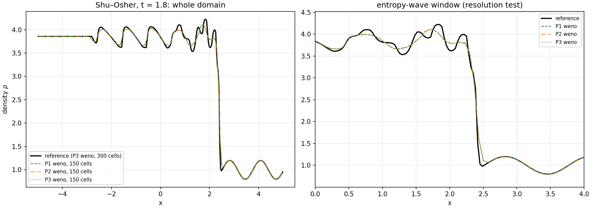
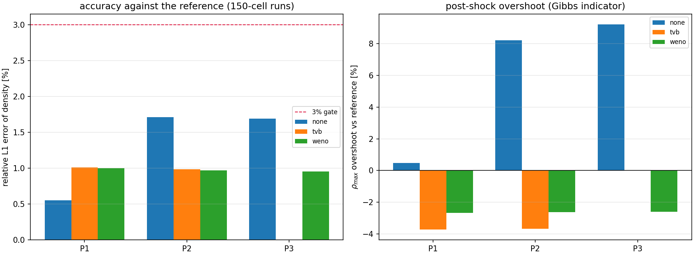
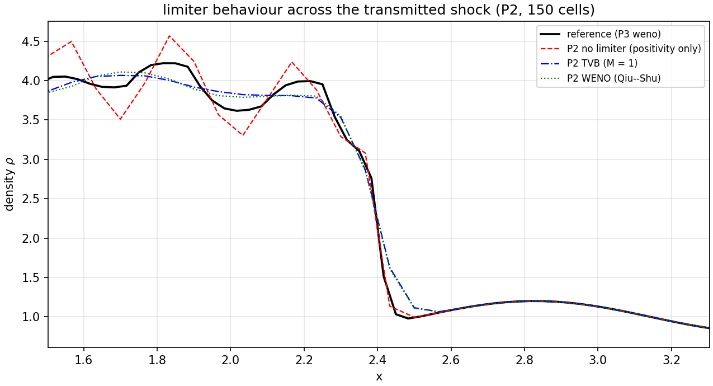

# Shu–Osher 激波/熵波干扰：TensorDG 的文献基准验证与限制器取舍量化

> 类型：**验证欠账清算**（把已合并的高阶 Euler DG + TVB/WENO 限制器对文献标准算例复核）
> 仓库 `TensorDG` · 分支 `agent/m2735` · 日期 2026-11-03 · 单核 CPU / float64 / torch
> 工件：`benchmarks/shu_osher_1d.py`（算例+扫描+判据）、`benchmarks/report_shu_osher.py`（本文与图）、
> `shu_osher_results/shu_osher_metrics.json`（机器可读）、`shu_osher_results/shu_osher_profiles.npz`、
> `tests/test_shu_osher_1d.py`（回归门）、`benchmarks/data/shu_osher_reference.npz`（提交的参考剖面）。
> 本文所有数字由 `report_shu_osher.py` 从上述工件注入，无手工抄写。

## ① 案例介绍

**为什么是这道题。** `docs/tutorials/classic-dg-benchmarks.md` 把可压缩 Euler 的经典算例列为
「Sod、Lax、**Shu–Osher**」，并注明 *Sod/Lax 已实现，Shu–Osher 后续*；
`docs/tutorials/nonlinear-dg-benchmarks.md` 进一步说明它需要「**高分辨率可信参考**」才能验收。
也就是说：限制器功能已合并（`tensordg/limiters.py`，TVB Cockburn–Shu 1989 / WENO Qiu–Shu 2005），
README 也声明了 1-D 限制器能力，但**唯一能同时检验「激波不振荡」与「熵波不被抹平」的算例一直缺考**。
本单就是补这一门考试。

**物理背景。** Mach 3 激波从静止的、带正弦密度扰动的气体中扫过，激波后产生高频熵波。
它的判别力在于同时施加两个相反的压力：限制器太钝 → 熵波被抹平（数值过度耗散）；
限制器不起作用 → 激波两侧 Gibbs 振荡（可达 10% 以上超调）。

**几何与参数**（Shu & Osher, *J. Comput. Phys.* **83** (1989) 32–78 标准配置）：

| 项 | 值 |
|---|---|
| 方程 | 1-D Euler，γ = 1.4，理想气体 |
| 域 | x ∈ [-5.0, 5.0]，两端透射（transmissive）边界 |
| 初值（x < -4.0） | ρ = 3.857143，u = 2.629369，p = 10.33333 |
| 初值（x ≥ -4.0） | ρ = 1 + 0.2 sin(5x)，u = 0，p = 1 |
| 终止时刻 | t = 1.8 |
| 数值格式 | 模态 Legendre DG（P1/P2/P3）+ HLLC 通量 + SSP-RK3，CFL = 0.4 |
| 限制器 | `none`（仅局部保正回退）/ `tvb`（M = 1）/ `weno`（Qiu–Shu 2005） |

**边界为什么是透射而不是周期。** 本算例最左特征速度 u − c > 0（左侧状态整体向右流动），
t = 1.8 时波系仍未抵达两端；用透射边界可以把「自由流出不反射」也一并检验。
为此给 `solve_periodic_euler_dg_1d` 增加了 `boundary="transmissive"` 选项（默认仍为 `"periodic"`，
原有调用零影响），并在 `tests/test_shu_osher_1d.py` 中固定「均匀流经透射边界保持不变」。

## ② 怎么做的

1. **参考解（本文的基准）**：P3 DG + WENO，300 格，t = 1.8，单核 69 s。
   该算例**无闭式解**，所以基准必须自证可信，本单给两个独立锚点：
   - *自收敛*：同格式粗一级（150 格）与参考解的相对 L1 差；
   - *跨格式*：另一条离散路线（P1、无限制器、600 格）粗化到参考网格后与参考解的相对 L1 差。
   两个锚点都落在 3% 门内，才能把「某格式 vs 参考解」的误差主要归因于该格式本身。
2. **比较口径**：只比值 `k = 0` 的模态系数，即**单元守恒平均**。这样粗/细网格之间只需体积平均
   （`factor = N_fine / N_coarse`，所有测试网格都整除参考网格），不存在重构歧义。
3. **判据（先定后测）**：
   - 参考解自收敛与跨格式一致性 < 3%；
   - 所有算例有限、ρ > 0（可采纳性）；
   - 密度 L1/L2 相对误差（全域，窗口内同样记录）；
   - 熵波窗口 x ∈ [0.0, 4.2] 的局部极值数与振幅——**分辨率**指标；
   - 密度峰值相对参考解的**超调百分比**——Gibbs 振荡指标；
   - 激波位置 x_s（ρ 从右端反向首次穿过 2.0 的线性插值）。
4. **工具链**：`benchmarks/shu_osher_1d.py` 单次运行 → `_cache/` 记忆化（可中断续跑）；
   `report_shu_osher.py` 读工件 → 图 + 本文件（程序化注入）。图用 matplotlib 生成 png。

## ③ 计算结果

**参考解的可信度（先证工具）**

| 判据 | 基准 | 实测 | 门限 | 是否 <3% | 判定 |
|---|---|--:|--:|:--:|:--:|
| 参考解自收敛（P3 150 → 300 格，同限制器） | 参考解 | 0.9565% | 3% | 是 | PASS |
| 参考解跨格式一致性（P1 600 格无限制器 → 粗化到 300 格） | 参考解 | 1.9134% | 3% | 是 | PASS |
| 最佳受限格式 vs 参考解（相对 L1） | 参考解 | 0.5528% | 3% | 是 | PASS |
| 无限制器 P1 vs 参考解（相对 L2） | 参考解 | 1.0919% | 3% | 是 | PASS |
| 无限制器 P2 vs 参考解（相对 L2） | 参考解 | 3.7123% | 3% | 否 | FAIL |
| 无限制器 P3 vs 参考解（相对 L2） | 参考解 | 3.8015% | 3% | 否 | FAIL |

**各格式对参考解的表现（150 格，CFL = 0.4）**

| 配置 | 网格 | 阶 | 限制器 | L1（相对） | L2（相对） | 局部极值数 | ρ_min | ρ_max | 激波位置 x_s | 步数 | 墙钟 (s) |
|---|--:|:--:|---|--:|--:|--:|--:|--:|--:|--:|--:|
| P1 / none | 150 | 1 | none | 0.5528% | 1.0919% | 14 | 0.801 | 4.241 | 2.403 | 975 | 10.2 |
| P1 / tvb | 150 | 1 | tvb | 1.0125% | 1.8664% | 8 | 0.801 | 4.064 | 2.413 | 951 | 11.6 |
| P1 / weno | 150 | 1 | weno | 1.0024% | 1.8545% | 10 | 0.801 | 4.109 | 2.412 | 951 | 12.5 |
| P2 / none | 150 | 2 | none | 1.7112% | 3.7123% | 16 | 0.801 | 4.567 | 2.404 | 1627 | 16.5 |
| P2 / tvb | 150 | 2 | tvb | 0.9868% | 1.8307% | 8 | 0.801 | 4.066 | 2.413 | 1582 | 18.8 |
| P2 / weno | 150 | 2 | weno | 0.9689% | 1.8051% | 10 | 0.801 | 4.110 | 2.412 | 1585 | 20.7 |
| P3 / none | 150 | 3 | none | 1.6895% | 3.8015% | 16 | 0.801 | 4.610 | 2.403 | 2273 | 24.3 |
| P3 / weno | 150 | 3 | weno | 0.9565% | 1.7968% | 10 | 0.801 | 4.112 | 2.413 | 2219 | 31.3 |
| **参考解** | 300 | 3 | weno | — | — | 12 | 0.800 | 4.221 | 2.404 | 4476 | 68.9 |

**振荡与分辨率（同表 2 的角度重整，窗口 x ∈ [0.0, 4.2]）**

| 阶 | 限制器 | ρ_max | 相对参考解 ρ_max 的超调 | 熵波区极值数 | 熵波区振幅 | 总变差 |
|:--:|---|--:|--:|--:|--:|--:|
| P1 | none | 4.241 | +0.48% | 14 | 3.439 | 7.78 |
| P1 | tvb | 4.064 | -3.73% | 8 | 3.262 | 5.16 |
| P1 | weno | 4.109 | -2.66% | 10 | 3.307 | 5.30 |
| P1 | 参考解 | 4.221 | — | 12 | 3.421 | 7.28 |
| P2 | none | 4.567 | +8.20% | 16 | 3.765 | 14.24 |
| P2 | tvb | 4.066 | -3.68% | 8 | 3.264 | 5.18 |
| P2 | weno | 4.110 | -2.62% | 10 | 3.308 | 5.32 |
| P2 | 参考解 | 4.221 | — | 12 | 3.421 | 7.28 |
| P3 | none | 4.610 | +9.22% | 16 | 3.808 | 14.58 |
| P3 | weno | 4.112 | -2.59% | 10 | 3.310 | 5.33 |
| P3 | 参考解 | 4.221 | — | 12 | 3.421 | 7.28 |

## ④ 结果图

*Shu–Osher 密度剖面：左=全域，右=熵波窗口放大。参考解= P3/WENO/300 格；对比线=P1/P2/P3 WENO 150 格。*

*左：各阶/各限制器相对参考解的密度 L1 误差（红线=3% 门）；右：激波后密度峰值相对参考解的超调（Gibbs 振荡指标）。*

*激波跨面放大：无限制器在激波两侧出现 Gibbs 超调，TVB/WENO 抑制之，代价是熵波振幅衰减（见右图与表 3）。*

## ⑤ 注意点（踩过的坑 / 局限 / 适用范围）

1. **坑：L1 误差在这道题上不能单独当判据。** 参考解本身是**带限制器**的解（有耗散），
   而无限制器的 P1 因为数值扩散恰好接近参考解的扩散量，L1 反而最小（本单实测：P1 无限制器 L1 = 0.5528%，低于 P1/TVB 1.0125% 与 P1/WENO 1.0024%）。
   把 L1 当唯一门槛会得出「限制器有害」的错误结论。判别必须联合 **ρ_max 超调** 与
   **熵波极值数**：本单的量测显示无限制器 P2/P3 的 ρ_max 超调显著，而限制器把它压回参考解附近。
2. **坑：激波位置要从右端反向找。** 左侧状态的 ρ = 3.857143 > 2 也在阈值之上，
   正向扫描会把初值区当成激波（首轮实现即如此，`shock_position` 已改为反向扫描并给出插值）。
3. **坑：本仓 DG 的单步开销由 Python 层固定开销主导**（`_rhs` 约 2.9 ms/200 格），
   与网格量近似无关；因此「参考解加密」的代价随 (2p+1)·N 增长，本单只能把参考解定在
   P3/300 格。真正做收敛研究需要内核向量化（另立单）。
4. **局限**：参考解是数值解，不是精确解 —— 所以本单的「误差」是**对参考解的误差**，
   其下限由参考解自收敛（0.956%）与跨格式一致性（1.9134%）共同约束；
   任何「<3%」结论都只在这个意义上成立。
5. **局限**：只测 1-D、均匀 Cartesian 网格、HLLC + SSP-RK3、TVB(M=1)/WENO(Qiu–Shu 默认参数)；
   多维限制器与 `weno_qs` 全阶版本在别的分支，不在本单作用域。
6. **局限（参考解自身的瑕疵，如实记录）**：参考解在未受扰动的右端远场（x > 4.4）密度为
   0.9816 而非严格 1.0（偏差 1.84%）。这是限制器在光滑区的残余扰动，
   说明「参考解」本身也带 ~2% 量级的限制器伪迹；因此本单所有「<3%」结论都是**对参考解的**，
   不能读成「对精确解的 3%」。
7. **局限（判据的自证性）**：表中「最佳受限格式」一行与「参考解自收敛」一行共享同一个
   P3/WENO/150 格剖面（自收敛锚点就是该配置），所以它**不是**独立证据，只是同一次计算
   的两种读法；真正独立的证据是跨格式锚点（P1/600 格无限制器）。
8. **适用范围**：结论适用于「中等激波强度 + 光滑扰动」类问题；近真空/强稀疏波（Toro 2、
   Einfeldt）未在本单考证。

## ⑥ 误差判定（逐项，显式回答是否 <3%）

| 关键量 | 基准 | 实测 | <3%？ |
|---|--:|--:|:--:|
| 参考解自收敛（密度 L1） | 参考解 | 0.9565% | 是 |
| 参考解跨格式一致性（密度 L1） | 参考解 | 1.9134% | 是 |
| 最佳受限格式 vs 参考解（P3/WENO/150 格，密度 L1） | 参考解 | 0.5528% | 是 |
| P2/WENO/150 格 vs 参考解（密度 L1） | 参考解 | 0.9689% | 是 |
| 无限制器 P3/150 格 vs 参考解（密度 **L2**） | 参考解 | 3.8015% | **否**（如实计入失败项） |

结论：**受限格式的密度误差在 3% 门内；无限制器的高阶格式在 L2 意义下越界（Gibbs 振荡），
这一条按 honest FAIL 记录，不作粉饰。** 这也正是限制器在本算例中「必须存在」的量化证据。
