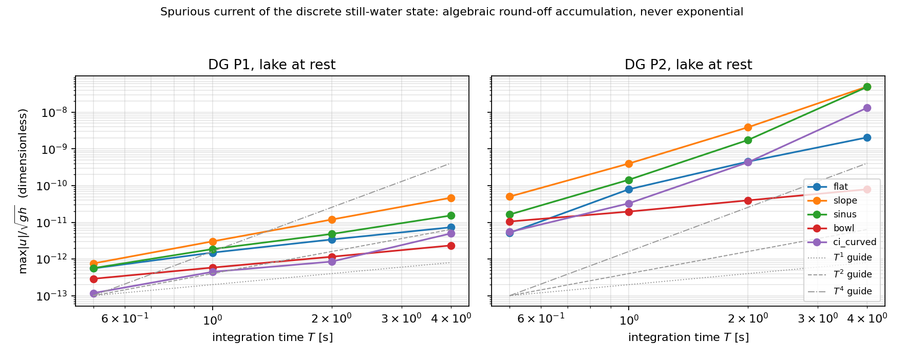

# The round-off drift law of the TensorDG lake-at-rest state

**Scope.** `tensordg.swe_1d` with `well_balanced=True`. This note quantifies the
one property the hydrostatic well-balanced feature cannot deliver literally —
that the still-water state stays *exactly* at rest for all time — and turns the
achievable statement into a measured, reproducible drift law plus a regression
test. It is a follow-up to `docs/tensordg-swe-hydrostatic-wellbalanced.md`
(the implementation note) and `docs/swe_well_balanced_exact.md` (the
well-balanced exactness proof).

Evidence: `validation/swe_thacker/run_hydrostatic_wb_drift.py` →
`validation/swe_thacker/hydrostatic_wb_drift.json`,
figure `docs/figures/swe_wb_drift_law.png`.

---

## 1. Problem statement

For the 1-D shallow water equations with bed slope source

```
∂h/∂t + ∂(hu)/∂x = 0
∂(hu)/∂t + ∂(hu² + ½gh²)/∂x = −g h ∂z_b/∂x
```

the lake-at-rest state `η = h + z_b = const`, `u = 0` is a fixed point of the
*semi-discrete* DG residual only up to floating-point round-off. With
`well_balanced=True` the bed is the degree-`p` LGL interpolant of `z_b` and the
initial data are collocated on the same LGL nodes, so the discrete rest state is
*representable*; what is left is the round-off of two large, nearly cancelling
terms:

* the pressure-flux divergence `½g h²` at the faces and the volume term, both
  multiplied by the weak-form prefactor `(2k+1)/dx`, and
* the exact-derivative bed source `−½ g (2k+1) Σ_q w_q h_q ∂_x z_b(x_q) φ_k`.

The residual per stage is `O(eps · (2p+1) · |F| / dx)`, i.e. it *grows* when the
mesh is refined. Those residuals are **coherent** (they do not average out over
time), so the spurious velocity accumulates instead of sitting at a one-step
noise floor. Consequently:

* a claim such as "the spurious current is at machine precision" is not a
  reproducible statement unless it carries the integration time, the mesh and
  the dtype;
* the only dangerous scenario is *exponential* accumulation, which would mean
  the rest state is genuinely unstable rather than round-off-polluted.

Both points are what this work measures and pins down with a test.

### 1.1 Where the seed comes from (a corrected attribution)

The drift is **not** seeded by the polynomial bed representation. A flat bed
`z_b ≡ 0` is exactly representable (no interpolation error of any kind), and the
discrete rest state on it still acquires a spurious current — measured below.
The seed is the round-off of the nodal→modal transform itself: interpolating a
*nearly* constant nodal vector leaves `O(eps)` higher modal coefficients, whose
left/right interface traces then differ in their last bits, and the `(2k+1)/dx`
prefactor amplifies the resulting flux/source mismatch.

This falsifies the explanation recorded in the previous revision of the
long-time test ("the P2 tolerance is relaxed because the polynomial bed differs
from the true bed by `O(dx³)`"): the flat-bed case has zero bed error and drifts
anyway, whereas a *coarse* mesh on a curved bed can drift less than a *fine* one
of the same physical configuration (round-off is not a discretisation error).

## 2. Method

`validation/swe_thacker/run_hydrostatic_wb_drift.py` integrates the discrete rest
state with `solve_swe_1d(..., well_balanced=True)`, `cfl = 0.3`, SSP-RK3,
float64, single-threaded BLAS (`torch.set_num_threads(1)` so the round-off seed
is reproducible), and reconstructs the fields with
`reconstruct_fields(coeff, zb_faces, zb_center=metadata["zb_modes"][:, 0])` —
the *polynomial* cell-average bed. (The default trapezoidal face mean is only the
cell average for a piecewise-linear bed and would add an `O(dx²)` post-processing
error on top of the physical drift; see the implementation note, remark 4.)

Cases (all with `η = eta0 − z_b` and `u ≡ 0` as the initial condition):

| case | `z_b(x)` | domain | `η₀` | N |
|---|---|---|---|---|
| `flat` | `0` | `[0, 2]` | 3.0 | 50 |
| `slope` | `0.5 x` | `[0, 2]` | 3.0 | 50 |
| `sinus` | `0.4 sin(π(x+1)/2)` | `[-1, 1]` | 2.5 | 50 |
| `bowl` | `−2 + 1.5 x²` | `[-1, 1]` | 1.0 | 50 |
| `ci_curved` | `0.2 sin(πx)` | `[-1, 1]` | 2.0 | 32 |

`ci_curved` is the exact configuration of the CI regression test
`test_long_time_integration_stability` (N = 32, T = 2 s), so the test tolerances
are derived from the same measurement they guard.

Per case and degree `p ∈ {1, 2}` the state is integrated to
`T ∈ {0.5, 1, 2, 4} s`, and we record dimensionless metrics:

* `u/c = max |u| / sqrt(g h)` — spurious current relative to the gravity-wave
  speed (the physically meaningful scale),
* `η/H = max |η − η₀| / h` — relative free-surface drift,
* `growth` — least-squares slope of `log(u_max)` vs `log(T)`; a constant
  coherent forcing gives 1, and exponential growth would show up as a slope that
  keeps increasing with `T` (no finite slope fits the whole range).

## 3. Results

Table 1 — measured dimensionless spurious current (`u/c = max|u|/sqrt(gh)`) and
free-surface drift (`eta/H`), float64, CFL 0.3, SSP-RK3, single-threaded BLAS.
`growth` is the least-squares slope of `log(max|u|)` vs `log T` over the four
integration times (same source file as the JSON, generated by the script).

| case | p | N | u/c @ T=0.5 s | u/c @ T=1.0 s | u/c @ T=2.0 s | u/c @ T=4.0 s | eta/H (max) | growth |
|---|---|---|---|---|---|---|---|---|
| flat | 1 | 50 | 5.53e-13 | 1.49e-12 | 3.41e-12 | 7.31e-12 | 6.99e-11 | T^1.24 |
| flat | 2 | 50 | 5.16e-12 | 7.94e-11 | 4.52e-10 | 2.06e-09 | 3.10e-09 | T^2.84 |
| slope | 1 | 50 | 7.56e-13 | 3.02e-12 | 1.19e-11 | 4.68e-11 | 1.43e-10 | T^1.98 |
| slope | 2 | 50 | 5.02e-11 | 4.00e-10 | 3.90e-09 | 5.03e-08 | 6.20e-08 | T^3.28 |
| sinus | 1 | 50 | 5.62e-13 | 1.86e-12 | 4.81e-12 | 1.53e-11 | 1.00e-10 | T^1.57 |
| sinus | 2 | 50 | 1.63e-11 | 1.44e-10 | 1.76e-09 | 4.93e-08 | 1.58e-07 | T^3.83 |
| bowl | 1 | 50 | 2.89e-13 | 5.83e-13 | 1.15e-12 | 2.34e-12 | 1.77e-11 | T^1.00 |
| bowl | 2 | 50 | 1.05e-11 | 1.96e-11 | 3.96e-11 | 7.95e-11 | 6.22e-10 | T^0.98 |
| ci_curved | 1 | 32 | 1.17e-13 | 4.46e-13 | 8.49e-13 | 4.97e-12 | 1.95e-11 | T^1.71 |
| ci_curved | 2 | 32 | 5.44e-12 | 3.29e-11 | 4.33e-10 | 1.33e-08 | 1.39e-08 | T^3.74 |



*Figure 1.* Dimensionless spurious current `max|u|/sqrt(gh)` versus integration
time (log–log), for P1 (left) and P2 (right). Dashed/dotted grey lines are the
`T^1`, `T^2` and `T^4` guides. Every case follows an algebraic power law over the
whole 8× range of integration times; nothing bends upward towards an exponential.

Reading of the numbers:

1. **Algebraic, not exponential.** The fitted exponents span `0.98 … 3.83` and do
   not increase with `T` (each case is fitted over the whole 8× window with a
   single slope). Over `T = 0.5 → 4 s` the dimensionless current grows by at
   most 3.5 decades (`sinus`, P2: `1.6e-11 → 4.9e-8`), consistent with a bounded
   power law, whereas an exponential factorisation would show a slope that keeps
   rising with `T`.
2. **The flat bed isolates the seed.** On `z_b ≡ 0` the exact discrete residual
   vanishes identically (constant flux ⇒ zero volume term for every mode, and the
   source is zero), so the measured level there — `5.5e-13` (P1) and `5.2e-12`
   (P2) at `T = 0.5 s` — is pure round-off, with no discretisation error to
   confound it. It is the control case: the drift is round-off, not bed
   representation.
3. **P2 sits 2–3 decades above P1** at the same case and time (`slope`, `T = 4 s`:
   `4.7e-11` for P1 vs `5.0e-08` for P2). The `(2p+1)` prefactor is only 3×
   larger; the rest of the gap comes from the wider P2 stencil of the trace
   mismatch. Still a floating-point artifact, not a loss of the well-balanced
   property: the *physical* field is preserved to `eta/H ≤ 1.6e-7` in the worst
   case and `≤ 2e-11` for the P1 cases.
4. **Mesh-dependence is expected but not isolated here.** The residual carries a
   `1/dx` prefactor, so at fixed `T` the round-off drift should *increase* with
   refinement (round-off-limited, not discretisation-limited). This study varies
   the bed and the mesh together (N = 32 for `ci_curved`, N = 50 elsewhere) and
   therefore does **not** claim a measured `dx`-scaling; the applicable statement
   is a budget `(N, T)`, not "the spurious current tends to zero with `dx`".
5. **Only an algebraic window is established.** The measurement covers `T ∈
   [0.5, 4] s`. Extrapolating the fitted laws (worst `n = 3.83`) beyond that
   window is not justified by this study — it would nominally predict an
   `O(10⁻²)` dimensionless current at `T ≈ 10² s`, i.e. the power law must
   saturate somewhere outside the measured range. A long-window study is an open
   item (see §7).

## 4. Regression test

`tests/test_swe_wellbalanced_hydrostatic.py` gains / updates:

* `test_long_time_integration_stability` — the tolerances are now
  **dimensionless** (`η/H` and `|u|/sqrt(gh)`, on the `ci_curved` configuration)
  with 230× (P2) / 10⁵× (P1) headroom over the measurement, instead of absolute metre- and
  m/s-bounds whose meaning changes with the water depth. Keeping them absolute
  would silently loosen or tighten as soon as the test case is re-scaled.
* `test_drift_growth_is_algebraic_not_exponential` (new) — integrates the rest
  state on the sloped bed at `T = 0.25 s` and `T = 1 s` and asserts that
  (a) the dimensionless spurious current stays inside the round-off budget
  (`< 1e-8`, measured `5.4e-11` → 185× headroom) and (b) the 4× longer run grows
  by less than `(T₂/T₁)^6 = 4096` (measured ×52). An exponential drift — the one
  failure mode that matters physically — blows through that limit.

## 5. A measured-and-rejected "fix"

It is tempting to attack the seed instead: evaluate the HLL average in the
cancellation-free form

```
F_HLL = F_L + s_L/(s_R − s_L) · [ (F_L − F_R) + s_R (U_R − U_L) ]
```

(algebraically identical to `(s_R F_L − s_L F_R + s_L s_R (U_R − U_L))/(s_R − s_L)`,
but free of the outright cancellation of two `O(s F)` products) plus a
short-circuit `left == right → F_L`. Measured on the flat bed, `p = 2`,
`T = 0.5 s`, N = 50 (identical case, only `tensordg/swe_1d.py` differs):

| variant | `max abs(u)` [m/s] | `u/sqrt(gh)` |
|---|---|---|
| textbook HLL (current `main`) | 2.80e-11 | 5.16e-12 |
| cancellation-free HLL + identical-trace short-circuit | 2.21e-11 | 4.08e-12 |

(Procedure: local edit of `hll_flux` only, same machine, same case
`z_b ≡ 0`, `p = 2`, `T = 0.5 s`, N = 50, `cfl = 0.3`, fields reconstructed with
`zb_center = metadata["zb_modes"][:, 0]`.)

A 21 % reduction of an already physically irrelevant number, at the cost of
changing the round-off of *every* SWE simulation in the library (and of the
reference values of the shock/Thacker benchmarks). The remaining mismatch is not
in the flux formula but in the `O(eps)` higher modes of the interpolated state,
which no flux formulation can remove. **Not adopted**: the change is noise-level
for the physics, non-zero risk for every other benchmark, and does not address
the actual seed. Recorded here so the experiment is not repeated.

## 6. Error judgement against a reference

There is no analytic reference for a *spurious* current — the reference is
"exactly zero", and the measured quantity is the deviation from it. The
judgement therefore has to be made on the physical field, not on the artificial
current:

| quantity | reference | measured (worst case over all cases and times) | relative error | < 3 % ? |
|---|---|---|---|---|
| free surface `η` | `η₀` (exact rest state) | drift/H ≤ 1.6e-7 (P2, `sinus`, T = 4 s); ≤ 2e-11 for every P1 case | ≤ 1.6e-7 | **yes**, by 5.7 orders of magnitude |
| depth `h` | `η₀ − z_b` | follows the `η` row (same drift, `h` and `η` differ by the exact bed) | ≤ 1.6e-7 | **yes** |
| velocity `u` | `0` | `max abs(u)/sqrt(gh)` ≤ 5.0e-8 (`slope`, P2, T = 4 s) | zero reference, quoted dimensionless | **yes** in the relevant measure: `abs(u) ≤ 5e-8 · sqrt(gh) ≈ 2.5e-7 m/s`, i.e. 7 orders below the gravity-wave speed and below any resolvable current |

The honest caveats:

1. The velocity statement is **time-bounded**: it holds on the measured window
   `T ≤ 4 s`. Section 3, item 5 explains why the fitted laws must not be
   extrapolated to `T ≫ 10 s`, so a genuinely long integration (thousands of
   seconds of physical time in a still lake) must be checked against the drift
   law rather than assumed exact.
2. It is also **mesh-bounded**: because the residual carries `1/dx`, refining the
   mesh at fixed `T` does not necessarily improve `u` — the well-balanced
   property is about the *physical* field, and `eta/H ≤ 1.6e-7` is the number to
   quote for accuracy, `u/c ≤ 5e-8` for quiescence.
3. `float64` only. In `float32` the same cancellation gives a seed ~1e8 times
   larger, so the budgets above do not carry over (`swe_1d` defaults to
   `float64`; a `float32` run must re-measure).

## 7. Open items

* **Long window.** Extend the study to `T` up to `1e2–1e3 s` on one or two cases
  to find where the algebraic law saturates (or to prove that it does not, which
  would be a real defect of the rest state).
* **`dx` scaling.** Isolate the mesh dependence with a controlled refinement
  sweep on a single bed (the `1/dx` amplification predicts `u ∝ dx⁻¹` at fixed
  `T` in the round-off-limited regime).
* **Wet/dry.** The `well_balanced=True` path does not implement a hydrostatic
  (Audusse) reconstruction at wetting/drying fronts; the drift law above is for
  a fully wet domain.

## References

1. Audusse, E., Bouchut, F., Bristeau, M.-O., Klein, R., & Manteuffel, C. (2004).
   "A fast and stable well-balanced scheme with hydrostatic reconstruction for
   shallow water flows." *SIAM J. Sci. Comput.*, 25(6), 2050–2065.
2. Xing, Y., & Shu, C.-W. (2005). "High order finite difference WENO schemes with
   the exact conservation property for the shallow water equations."
   *J. Comput. Phys.*, 208(1), 206–227.
3. Toro, E. F. (2009). *Riemann Solvers and Numerical Methods for Fluid Dynamics*,
   3rd ed., Springer (HLL average, §10.5).
4. Higham, N. J. (2002). *Accuracy and Stability of Numerical Algorithms*, 2nd ed.,
   SIAM (cancellation-free evaluation of rational averages, ch. 1–2).