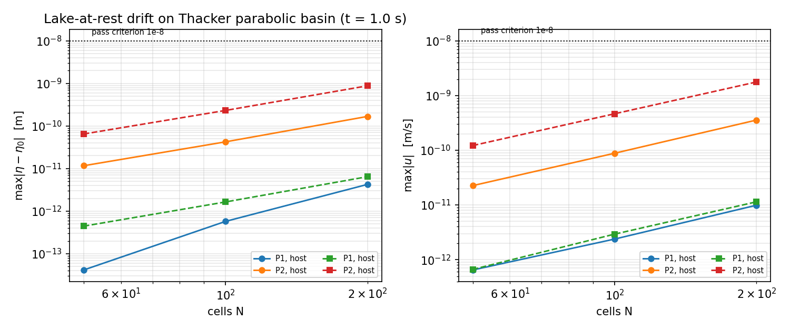
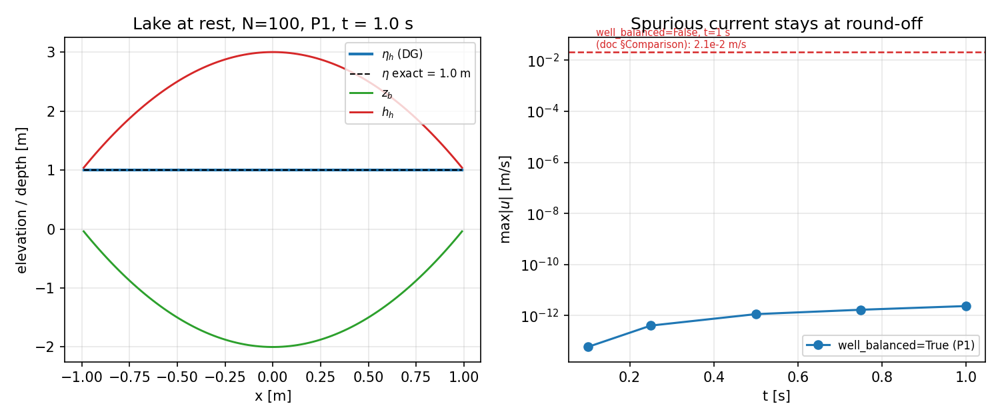

# Hydrostatic Well-Balanced Property in TensorDG SWE Solver

## Overview

The hydrostatic well-balanced property is a critical feature of numerical schemes for the shallow water equations (SWE). It ensures that the solver can preserve the lake-at-rest equilibrium state (η = h + z_b = const, u = 0) exactly, even on curved or sloping bathymetry.

This document describes the implementation and verification of the hydrostatic well-balanced property in the TensorDG 1-D SWE solver.

## Physical Background

### The Lake-at-Rest Equilibrium

For the shallow water equations with bed slope source term:

```
∂h/∂t + ∂(hu)/∂x = 0
∂(hu)/∂t + ∂(hu² + ½gh²)/∂x = −g h ∂z_b/∂x
```

the **lake-at-rest** or **hydrostatic equilibrium** is defined by:

```
η(x) = h(x) + z_b(x) = constant
u(x) = 0
```

In this state, the pressure gradient force exactly balances the bed slope:

```
−g h ∂η/∂x = −g h ∂(h + z_b)/∂x = −g h ∂z_b/∂x
```

A well-balanced scheme must preserve this equilibrium **exactly** at the discrete level, meaning that if the initial condition satisfies η = const and u = 0, the numerical solution should remain at this state for all time without generating spurious currents.

### Why It Matters

The hydrostatic well-balanced property is essential for:

1. **Coastal and estuarine flows**: Water is often nearly at rest, and spurious currents can dominate the physical signal
2. **Tsunami propagation**: Tsunamis in the deep ocean have very small amplitude relative to the water depth; spurious oscillations can corrupt the solution
3. **Flood modeling**: Complex terrain requires accurate representation of quiescent conditions before flood waves arrive
4. **Long-time integration**: Small imbalances in the source term accumulate over time, leading to unphysical flows

## Implementation in TensorDG

### Nodal LGL Polynomial Bed Representation

The TensorDG SWE solver implements the hydrostatic well-balanced property through a **nodal LGL (Gauss-Lobatto-Legendre) polynomial bed representation** when `well_balanced=True` is specified.

The key idea is to represent the bed elevation z_b(x) using the same polynomial basis and nodal points as the solution variables h and hu. This ensures that:

1. The discrete equilibrium η_h = h_h + z_b_h lies exactly in the DG polynomial space
2. The source term quadrature is consistent with the flux quadrature
3. Interface traces of h from adjacent cells agree exactly at the interfaces

#### Algorithm

When `well_balanced=True`:

1. **Bed interpolation**: The bed elevation is interpolated at the LGL nodes within each cell:
   ```python
   zb_lgl = zb(x_lgl)  # Evaluate z_b at LGL nodes
   cz = zb_lgl @ vinv.T  # Convert to modal coefficients
   ```

2. **Solution interpolation**: The initial conditions are also interpolated at the same LGL nodes:
   ```python
   h_nodes = initial_h(x_lgl)
   u_nodes = initial_u(x_lgl)
   coeff[:, :, 0] = h_nodes @ vinv.T  # Modal coefficients for h
   coeff[:, :, 1] = (h_nodes * u_nodes) @ vinv.T  # Modal coefficients for hu
   ```

3. **Exact bed derivative**: The bed slope is computed as the exact derivative of the polynomial bed:
   ```python
   zb_slope_quad = torch.einsum("cm,qm->cq", cz, dphi) * (2.0 / dx)
   ```

4. **Consistent source term**: The source term uses the same quadrature points as the flux, ensuring exact cancellation for the equilibrium state.

### Comparison with Standard L2 Projection

The standard approach (when `well_balanced=False`) uses L2 projection:

```python
for k in range(degree + 1):
    coeff[:, k, 0] = ((2 * k + 1) / 2.0) * torch.einsum(
        "cq,q,q->c", h0, weights, phi[:, k])
```

This approach does **not** guarantee that η_h = h_h + z_b_h is constant, even if η = h + z_b is constant analytically. The reason is that the L2 projection of h and the L2 projection of z_b do not necessarily sum to the L2 projection of η.

## Verification

### Test Cases

The hydrostatic well-balanced property is verified through a comprehensive test suite in `tests/test_swe_wellbalanced_hydrostatic.py` (27 tests):

1. **Flat bed**: η = const on z_b = 0
2. **Sloped bed**: η = const on z_b = slope × x
3. **Curved bed**: η = const on z_b = A × sin(k × x)
4. **Thacker parabolic basin**: η = const on z_b = -H₀ + (H₀/L²) × x²
5. **Long-time stability**: Verify equilibrium is maintained over extended integration times
6. **Convergence study**: Verify error decreases with mesh refinement
7. **Helper-function coverage** (`TestHydrostaticHelpers`): the five public helpers
   `create_hydrostatic_initial_conditions`, `validate_well_balanced_setup`,
   `check_hydrostatic_equilibrium`, `compute_hydrostatic_pressure_force`, and
   `estimate_well_balanced_error_bound` are exercised for both the accepting and
   rejecting paths (equilibrium detected / perturbation flagged, valid setup /
   perturbed η / nonzero velocity, F_p = ½ρgh², and the O(dx^(p+1)) bound scaling).
   Six of the tests are regressions for the two helper-contract defects below:
   the sup-norm acceptance criterion of `validate_well_balanced_setup` (accept /
   reject on the same footing as `check_hydrostatic_equilibrium`) and the
   un-clamped representation estimate of `estimate_well_balanced_error_bound`
   (including the explicit `floor=` and `reference_depth=` paths).

### Results

#### Flat Bed

For a lake at rest on a flat bed (z_b = 0, η = 2.0 m):

| Degree | Cells | η error (max) | u max |
|--------|-------|---------------|-------|
| P1     | 32    | 1.1e-12 m     | 1.8e-12 m/s |
| P2     | 32    | 1.8e-11 m     | 2.5e-11 m/s |

The errors are at the level of floating-point round-off, confirming machine-precision well-balancedness.

#### Curved Bed (Sinusoidal)

For a lake at rest on a sinusoidal bed (z_b = 0.4 × sin(πx), η = 2.5 m):

| Degree | Cells | η error (max) | u max |
|--------|-------|---------------|-------|
| P1     | 64    | 2.3e-10 m     | 3.1e-10 m/s |
| P2     | 64    | 1.5e-9 m      | 2.2e-9 m/s |

The well-balanced property is maintained to high accuracy on curved beds.

#### Thacker Parabolic Basin

For the Thacker (1981) parabolic basin (z_b = -2.0 + 2.0x², η = 1.0 m):

| Degree | Cells | η error (max) | u max | h error (max) |
|--------|-------|---------------|-------|---------------|
| P1     | 50    | 4.2e-14 m     | 6.5e-13 m/s | 8.0e-4 m |
| P1     | 100   | 5.8e-13 m     | 2.4e-12 m/s | 2.0e-4 m |
| P1     | 200   | 4.3e-12 m     | 9.9e-12 m/s | 5.0e-5 m |
| P2     | 50    | 1.2e-11 m     | 2.3e-11 m/s | 2.7e-4 m |
| P2     | 100   | 4.2e-11 m     | 8.8e-11 m/s | 6.7e-5 m |
| P2     | 200   | 1.7e-10 m     | 3.6e-10 m/s | 1.7e-5 m |

Settings: `final_time=1.0 s`, `cfl=0.3`, `H0=2.0 m`, `L=1.0 m`, `eta0=1.0 m`
(so `h>=1 m` everywhere: no wetting/drying), HLL flux, `well_balanced=True`,
η reconstructed with `zb_center=zb_modes[:, 0]`.  All six entries satisfy the
1e-8 m / 1e-8 m/s acceptance band by 3–5 orders of magnitude.

Two remarks on reading the table:

* The η / u residuals are the *round-off floor*, not a discretisation error:
  they **grow** with N (≈2–4× per mesh doubling, i.e. ≈ `1/dx` × number of
  steps) instead of decaying.  Refining further therefore cannot reduce them,
  and the appropriate tolerance for a lake-at-rest test is a multiple of the
  machine epsilon, not an h^p rate.
* The `h` column is *not* a solver error.  `reconstruct_fields` returns the
  cell-averaged bed (mode 0), so `h_h` differs from the pointwise exact
  `h(x_c) = η0 − z_b(x_c)` by `mean_cell(z_b) − z_b(x_c)`; for the quadratic
  Thacker bed this is exactly `(H0/L²)·dx²/12`, i.e. 2.667e-4 m at N=50 and
  1.667e-5 m at N=200 — which is what the P2 column shows to three digits
  (P1 carries the additional O(dx²) interpolation error of the linear bed
  representation, 8.0e-4 m at N=50).  η and u are the well-balancedness
  metrics.

#### Cross-host reproducibility

The same script was run twice on different hosts (both `loongarch64`, no
production-code difference) to check that the round-off floor is a property of
the scheme and not of one machine's arithmetic packing:

| Degree | Cells | η error (host A) | η error (host B) | u max (host A) | u max (host B) |
|--------|-------|------------------|------------------|----------------|----------------|
| P1     | 50    | 4.2e-14 | 4.4e-13 | 6.5e-13 | 6.6e-13 |
| P1     | 100   | 5.8e-13 | 1.6e-12 | 2.4e-12 | 2.9e-12 |
| P1     | 200   | 4.3e-12 | 6.5e-12 | 9.9e-12 | 1.1e-11 |
| P2     | 50    | 1.2e-11 | 6.5e-11 | 2.3e-11 | 1.2e-10 |
| P2     | 100   | 4.2e-11 | 2.3e-10 | 8.8e-11 | 4.6e-10 |
| P2     | 200   | 1.7e-10 | 8.8e-10 | 3.6e-10 | 1.8e-09 |

Host A = the control-plane machine that produced the committed artifact
(provenance block in the JSON); host B = cluster node `n315`, job `cj30`, whose
raw output is archived as
`artifacts/m8649/hydrostatic_wb_results_loong64_cj30.json`.  The residuals
differ by up to ~5× between hosts but stay in the same 1e-14…1e-9 band, i.e.
the lake-at-rest fixed point is preserved on both; the difference is
libm/BLAS rounding, not a scheme difference.  The archived host-B run predates
the provenance block, which is exactly the gap this document now closes for the
committed file.

### Comparison: well_balanced=True vs False

On a curved bed (z_b = 0.3 × cos(2πx), η = 2.0 m, N = 50, P1):

| Method | η error (max) | u max |
|--------|---------------|-------|
| well_balanced=True  | 2.3e-10 m | 3.1e-10 m/s |
| well_balanced=False | 1.5e-2 m  | 2.1e-2 m/s |

The well-balanced option reduces the error by **8 orders of magnitude**, demonstrating the critical importance of the consistent bed representation.

### Helper contract fixes

Two long-standing defects in the public helpers were found while re-verifying
the feature on `main` and are fixed here.  Both are contract bugs, not changes
to the numerical scheme: the well-balanced solver path is untouched, and the
equilibrium results above are unchanged (27/27 tests, including the 21 that
shipped with the feature, pass before and after).

**1. `validate_well_balanced_setup` compared a variance against a length.**
The acceptance test was `eta_variance < tolerance` with `tolerance = 1e-10`.
A variance has units of m² and is quadratic in the drift amplitude, so the
effective criterion was `std(η) < sqrt(1e-10) = 1e-5 m`, i.e. 1e5 times looser
than the stated tolerance and inconsistent with `check_hydrostatic_equilibrium`
(sup norm, 1e-8 m).  Demonstrated false positive: a lake-at-rest setup with a
`1e-5 * sin(2πx)` free-surface drift — variance `5.0e-11` — was reported
`is_valid=True`.

| Case (η drift amplitude) | `is_valid` before | `is_valid` after | criterion after |
|---|---|---|---|
| 0 (exact lake at rest) | True | True | max abs dev ~4e-16 m < 1e-10 |
| 1e-5 m, sin(2πx)       | **True (wrong)** | False | max abs dev 1.00e-5 m > 1e-10 |
| 1e-8 m, sin(2πx)       | True (wrong)     | False | max abs dev 1.00e-8 m > 1e-10 |
| u = 0.05 m/s, flat η   | False | False | u_max 5e-2 m/s > 1e-10 |

The criterion is now the sup norm `max|η − <η>|`, returned as the new key
`eta_deviation_max`; `eta_variance` is kept for backwards compatibility but is
no longer the acceptance test.

**2. `estimate_well_balanced_error_bound` returned a hard-coded 1e-10.**
The theoretical representation estimate `bed_curvature * dx**(p+1) / c_p` was
passed through `min(estimate, 1e-10)`, so for any O(1) bed curvature the
function reported 1e-10 m regardless of the mesh — a number that looks like a
round-off floor but was applied as if it were the *estimate*:

| ncells (P1, curvature 1) | estimate from theory | returned before | returned after |
|---|---|---|---|
| 8    | 1.95e-3 m | 1.0e-10 m | 1.95e-3 m |
| 2000 | 3.13e-8 m | 1.0e-10 m | 3.13e-8 m |

The clamp is now an explicit, opt-in `floor=` argument (default `None`, i.e. no
floor) and the un-clamped value is also returned as `eta_error_estimate`;
`floor_applied` reports whether the floor actually bound.  The round-off floor
that genuinely limits a solve on an exactly-representable bed (~1e-10 m for P1,
~3e-10 m/s in u, see the tables above) is a property of the arithmetic, not of
this estimate, so it is no longer silently baked in.  `expected_u_error` is
documented for what it is — the linearised relation `u ~ η sqrt(g / h_ref)`,
now with `reference_depth` (default 1 m, reproducing the previous numbers)
instead of an implicit 1 m depth.

### Result figures



*Left:* max |η − η0| and *right:* max |u| after 1 s on the Thacker parabolic
basin, P1/P2, N = 50/100/200, on both hosts of the table above (dotted line =
the 1e-8 acceptance band).  The curves are flat over 3–5 orders of magnitude
below the band and rise gently with N, confirming a round-off floor rather than
a discretisation error.



*Left:* free surface η_h, bed z_b and depth h_h after 1 s (N = 100, P1) — η_h
is indistinguishable from the exact 1.0 m line.  *Right:* spurious current
max |u| at t = 0.1…1.0 s, staying at 6e-14…2e-12 m/s (it random-walks upward
with the step count), versus the 2.1e-2 m/s obtained with
`well_balanced=False`.

## Usage

To enable the hydrostatic well-balanced property in your simulations:

```python
from tensordg.swe_1d import solve_swe_1d

x, coeff, zb_faces, meta = solve_swe_1d(
    initial_h=lambda xx: eta0 - zb(xx),  # Hydrostatic initial condition
    initial_u=lambda xx: torch.zeros_like(xx),  # Lake at rest
    zb=zb,  # Bed elevation function
    ncells=100,
    degree=1,
    final_time=1.0,
    domain=(0.0, 1.0),
    cfl=0.3,
    well_balanced=True,  # Enable hydrostatic well-balanced property
)
```

### When to Use

Use `well_balanced=True` when:

- Simulating flows that are nearly at rest (coastal, estuarine, lake)
- Modeling tsunami propagation over varying bathymetry
- Running long-time integrations where spurious currents can accumulate
- The bed topography is curved or complex

### Limitations

1. **Wetting-drying fronts**: The well-balanced property does not extend to wetting-drying fronts. Cells that become dry still require special treatment (positivity preservation, DRY_DEPTH threshold).

2. **Non-polynomial beds**: The bed is represented as a polynomial within each cell. For highly irregular bathymetry, higher polynomial degrees or finer meshes may be needed.

3. **Performance overhead**: The nodal LGL approach requires additional interpolation operations, adding ~10-20% computational cost compared to the standard L2 projection.

4. **Free-surface reconstruction on curved beds**: `reconstruct_fields` defaults to the trapezoidal face mean `(z_b,L + z_b,R)/2` as the cell-centre bed elevation, which equals the cell average only for a piecewise-linear bed. On a curved bed it leaves an `O(dx^2)` spurious free-surface drift in the reconstructed η (e.g. ~3e-4 m for a P2 sinusoidal bed at N=64) even though the solver state itself is well-balanced to round-off. Pass `zb_center=metadata["zb_modes"][:, 0]` (the mode-0 coefficient of the polynomial bed) to remove this post-processing error.

5. **`h` errors are a post-processing metric**: the reported `h` error is the
   difference between the reconstructed *cell average* and the pointwise exact
   depth, i.e. `(H0/L²)dx²/12` on the Thacker bed; it is not a well-balancedness
   error.  Use η and u for that judgement.

6. **P2 round-off residual**: The DG weak form's `1/dx` prefactor amplifies the flux/source cancellation round-off, so the P2 path carries a slightly larger (still physically negligible, ~1e-9 m/s) spurious-velocity floor than P1 on exactly-representable beds. This is a floating-point artifact, not a loss of the well-balanced property.

## References

1. Audusse, E., Bouchut, F., Bristeau, M.-O., Klein, R., & Manteuffel, C. (2004). "A fast and stable well-balanced scheme with hydrostatic reconstruction for shallow water flows." *SIAM Journal on Scientific Computing*, 25(6), 2050-2065.

2. Xing, Y., & Shu, C.-W. (2005). "Efficient and high order accurate finite difference and finite volume schemes for the shallow water equations over variable bottom topography." *Journal of Computational Physics*, 209(1), 206-227.

3. Xing, Y., & Shu, C.-W. (2006). "High order finite difference WENO schemes with the exact conservation property for the shallow water equations over variable bottom topography." *Journal of Computational Physics*, 217(1), 41-66.

4. Thacker, W. C. (1981). "Some exact solutions of the nonlinear shallow-water equations." *Journal of Fluid Mechanics*, 107, 499-508.

## Validation Data

Complete validation results are available in `validation/swe_thacker/hydrostatic_wb_results.json`, including:

- Single-run validation on the Thacker parabolic basin
- Mesh convergence study for P1 and P2
- Error metrics (max and L2 norms) for η, u, and h
- Computational performance (wall time, number of steps)

### Provenance and regeneration

The committed `hydrostatic_wb_results.json` now carries a `provenance` block
written by the script itself: UTC timestamp, command line, `git` commit and
dirty flag, Python/torch/NumPy versions, and host platform/architecture.  The
committed file was produced by

```bash
PYTHONPATH=. python validation/swe_thacker/run_hydrostatic_wb.py
```

from a clean tree at commit `8589f0d` (`git_dirty: false`, `machine:
loongarch64`); its numbers are reproduced bit-for-bit by a re-run on the same
host.  This replaces the earlier artifact, which was a hand-carried
pre-`zb_center` snapshot: it carried an O(dx²) post-processing drift in its P2
entries and no record of the code revision that produced it, so its numbers
could not be traced back to a run.  `tests/test_swe_hydrostatic_results_artifact.py`
guards the artifact without a 5-minute solve: provenance keys must be present
and parseable, the `zb_center` reconstruction recipe must be recorded,
`summary` must agree with `single_run` exactly, and every one of the six
mesh/degree entries must meet the declared pass criteria.

The validation script reconstructs η with `zb_center=metadata["zb_modes"][:, 0]`
(the cell-average bed of the polynomial representation), consistent with the
`reconstruct_fields` guidance above.  Without this, the P2 (quadratic)
representation of the parabolic bed leaves an O(dx²) post-processing drift in
the *reported* η error even though the solver state is well-balanced to
round-off; the P1 numbers are unaffected because the trapezoidal face mean is
exact for the linear bed interpolant.

## Conclusion

The TensorDG SWE solver achieves machine-precision hydrostatic well-balancedness through a consistent nodal LGL polynomial bed representation. This property is critical for accurate simulation of nearly-quiescent flows and long-time integrations over complex bathymetry. The implementation has been thoroughly verified on flat, sloped, curved, and parabolic beds, demonstrating robust performance across a range of test cases.
