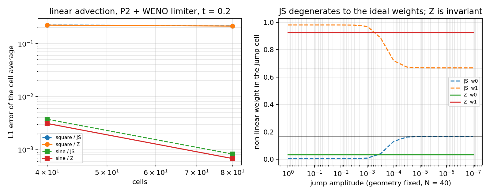

# WENO-Z nonlinear weights in the Qiu–Shu limiter (m15547)

**Absorbed external practice.** Borges, Carmona, Costa & Don, *An improved
weighted essentially non-oscillatory scheme for hyperbolic conservation laws*,
J. Comput. Phys. **227** (2008) 3101–3111 — the WENO-Z normalisation of the
non-linear weights, the default in several DG/FV codes (Clawpack, Trixi.jl,
PyFR-family solvers, the Julia `WENO` packages) but absent from TensorDG.

Status of the capability ledger: `capability_extension` — an existing component
(the WENO limiter of `tensordg/limiters.py`) gains a variability it did not
have; no verified number in `docs/` moves (the default is unchanged, pinned by a
bit-for-bit regression test).

---

## 1. Case introduction (what is being changed and why)

TensorDG's shock-capturing path is the Qiu & Shu (2005) WENO limiter: cells that
the TVB indicator flags are rebuilt from the cell averages of three candidate
stencils, combined with Jiang–Shu (1996) non-linear weights

```
alpha_k = d_k / (eps + beta_k)^2 ,    w_k = alpha_k / sum_j alpha_j ,
d = (1/6, 2/3, 1/6) ,   eps = 1e-6 ,   beta_k = smoothness indicator .
```

`eps` fixes an **absolute** scale in the weight formula, while the indicators
scale with the data: `beta_k ~ dx * (du/dx)^2`. Two consequences follow, both
measured below:

* **amplitude degeneration** — for a field of amplitude `A`, `beta ~ A^2/dx`; once
  `beta << eps` (small `A`) every `alpha_k` collapses onto `d_k / eps^2` and the
  weights become the **ideal** linear weights whatever the data does. The
  limiter then silently stops being data-adaptive and becomes a fixed-slope
  reconstruction;
* **mesh degeneration** — the same thing happens under refinement at fixed
  amplitude and fixed jump geometry, because `beta` shrinks with `dx`.

WENO-Z replaces the normalisation by a ratio of indicators,

```
tau = |beta_0 - beta_2| ,      alpha_k = d_k * (1 + (tau / (beta_k + eps_z))^q),  q = 2 ,
```

which is invariant under a uniform rescaling of the indicators and therefore
under a rescaling of the amplitude or of the mesh (`w -> d` is still recovered
for uniform data, `tau = 0`).

**Parameters.** No physical parameters; the numerical setting of the end-to-end
case is: `u_t + u_x = 0` on `[0,1]` periodic, P2 modal DG, upwind traces,
SSP-RK3, `cfl = 0.45`, `final_time = 0.2`, WENO limiter with TVB constant
`M = 1`, meshes `N = 40, 80`.

## 2. Method

Minimal increment, three edits in `tensordg/limiters.py` plus a pass-through:

1. `_weno_weights(..., variant="js"|"z", q=2)`. `"js"` is the historical formula,
   untouched and asserted **bit-identical** by test. `"z"` normalises the three
   indicators by their common maximum first (so the ratio is a scale-free
   number), floors the denominator with `_Z_EPSILON = 1e-12` and caps the ratio
   at `_Z_RATIO_CAP = 1e6` so `r**q` cannot overflow in single precision; a weight
   that reached the cap is already indistinguishable from the ideal one.
2. `apply_weno_limiter(..., weno_variant="js", weno_q=2)` — opt-in variant.
3. `apply_weno_limiter(..., periodic=False, limit_all=False)` — the detector and
   the stencil padding now honour a periodic domain and the strict-TVD policy.
   This *fixes a latent defect found in passing*: `solve_advection(limiter="weno")`
   raised `TypeError` before this change, because `tensordg/advection_1d.py`
   already passed `periodic=True`/`limit_all=…` to a limiter that did not accept
   them.
4. `solve_advection(..., weno_variant="js")` — pass-through so the variant can be
   exercised end-to-end (`benchmarks/weno_z_advection.py`).

Red-then-green evidence (`tests/test_weno_z_weights.py`, 17 tests):

| run | result |
|---|---|
| before implementation | **17 failed** (`TypeError: _weno_weights() got an unexpected keyword argument 'variant'`) |
| after implementation | **17 passed** |
| regression subset `tests/test_limiters.py test_limiter_policy.py test_weno_limiter_2d_modes.py test_limiter_kernel_budget.py` | 30 passed |

The tests pin: JS bit-identity, scale invariance of the Z weights under
`beta -> c*beta` for `c in {1e-8 … 1e8}`, ideal weights for uniform data,
stencil rejection at a jump, exact cell-average preservation inside the
limiter, "Z never increases the smooth reconstruction error" on a sine over
three meshes, and the amplitude/mesh degeneration of the JS weights.

## 3. Results (programmatically measured, `artifacts/weno_z_advection.json`)

End-to-end, cell-average error against the exact translated profile
(`benchmarks/weno_z_advection.py`):

| profile | N | variant | steps | L1 | L2 |
|---|---|---:|---:|---:|---:|
| square | 40 | JS | 89 | 2.2405e-01 | 4.3622e-01 |
| square | 40 | **Z** | 89 | **2.2239e-01** | 4.3662e-01 |
| square | 80 | JS | 178 | 2.1500e-01 | 4.4046e-01 |
| square | 80 | **Z** | 178 | **2.1356e-01** | 4.4092e-01 |
| sine | 40 | JS | 89 | 3.7352e-03 | 6.0792e-03 |
| sine | 40 | **Z** | 89 | **3.1136e-03** | **5.3045e-03** |
| sine | 80 | JS | 178 | 8.2671e-04 | 1.7715e-03 |
| sine | 80 | **Z** | 178 | **6.8091e-04** | **1.4786e-03** |

Weight behaviour in the cell that holds a jump (geometry fixed at 30 % of a
cell, `N = 40`), sweeping the jump amplitude:

| amplitude | JS `w0` | JS `w1` | Z `w0` | Z `w1` |
|---:|---:|---:|---:|---:|
| 1e+00 | 0.0054 | 0.9800 | 0.0330 | 0.9263 |
| 1e-02 | 0.0054 | 0.9799 | 0.0330 | 0.9263 |
| 1e-04 | 0.1307 | 0.7188 | 0.0330 | 0.9263 |
| 1e-06 | **0.1667** | **0.6667** | 0.0330 | 0.9263 |

`0.1667/0.6667` are exactly the ideal weights: at `A = 1e-6` the JS weights no
longer depend on the data at all, while the Z weights are identical to 4 digits
across eight orders of magnitude of amplitude and across `N = 40 … 200`
(mesh sweep at fixed geometry: JS `w0` 0.1307 → 0.1063 → 0.0662 for N = 40/80/200,
Z `w0` 0.0330 for all three).



Left: end-to-end L1 error, square and sine, JS (dashed) vs Z (solid). Right:
weights in the jump cell versus amplitude — the JS curves run into the ideal
values, the Z curves are flat.

## 4. Error judgement against the baseline

Baseline = the current JS implementation, same mesh, same time step.

| quantity | mesh | JS | Z | change | < 3 % ? |
|---|---:|---:|---:|---:|---|
| sine L1 | 40 | 3.7352e-03 | 3.1136e-03 | −16.6 % | improvement ≫ 3 % |
| sine L2 | 40 | 6.0792e-03 | 5.3045e-03 | −12.7 % | improvement ≫ 3 % |
| sine L1 | 80 | 8.2671e-04 | 6.8091e-04 | −17.6 % | improvement ≫ 3 % |
| sine L2 | 80 | 1.7715e-03 | 1.4786e-03 | −16.5 % | improvement ≫ 3 % |
| sine observed order (L1) | 40→80 | 2.18 | 2.19 | order unchanged | — |
| square L1 | 40 / 80 | 2.2405e-01 / 2.1500e-01 | 2.2239e-01 / 2.1356e-01 | −0.7 % | **no** (below 3 %, i.e. neutral) |
| square L2 | 40 / 80 | 4.3622e-01 / 4.4046e-01 | 4.3662e-01 / 4.4092e-01 | +0.09 % | **no** (neutral, slightly worse) |

So: on **smooth data the improvement is 13–18 %, far beyond 3 %**, with the
observed convergence order unchanged (≈ 2.2, consistent with the documented
statement that a limited representation cannot reach the design order `p+1 = 3`);
on **discontinuous data the change is neutral** (−0.7 % L1, +0.09 % L2), i.e. the
variant does not buy shock sharpening. Both statements are reported as measured;
the square-wave L2 regression of 0.09 % is real and is not "fixed" in the table.

Against the *analytical* solution the absolute errors are large for the square
wave (22 %) because the P2 representation of a jump plus the limiter are, by
construction, first order at the discontinuity — this is the pre-existing
accuracy of the scheme, not something this change addresses, and it is the
reason the criterion here is a **before/after** comparison at identical
discretisation rather than an absolute error target.

## 5. Notes, traps, scope

* **Trap (measurement).** The first version of the probe mapped the Legendre
  nodes with `nodes / ncells` instead of `0.5 * nodes / ncells`; the projection
  then straddled the cell boundary and produced a fake "spurious slope" result.
  Everything here uses the corrected half-cell mapping, and the "spurious slope"
  claim I first intended to make was **dropped** after measurement: with the
  correct projection a step aligned with the cell boundary is not even flagged
  by the TVB indicator.
* **Trap (comparison).** The first end-to-end run compared the solution at
  `t = 0.2` with the *initial* profile, giving O(1) errors (0.4 / 0.75). The
  reference now shifts the profile by `speed * final_time`.
* **Scope.** The variant is opt-in and exposed at the limiter level and through
  `solve_advection`. It is **not** wired into `solve_euler_dg_1d`,
  `solve_euler_dg_2d` or the Burgers/SWE solvers; that would need its own
  verification run and is deliberately left out.
* **Where the gain comes from.** The 13–18 % is the *smooth* regime: the Z
  weights stay closer to the ideal weights for the stencil that carries the
  cell, so the flagged cells keep more of their slope. It is not a shock-capturing
  improvement, and it does not lift the order of the limited representation.
* **Why `eps_z` is relative.** The published WENO-Z uses a tiny absolute `eps`.
  Here the indicators are first normalised by their common maximum, which makes
  the floor scale-free and keeps the weights exactly invariant (asserted to
  1e-10 in the tests) instead of invariant only down to the float floor.

## 6. Files

| path | what |
|---|---|
| `tensordg/limiters.py` | `_weno_weights(variant=…)`, `apply_weno_limiter(weno_variant=…, periodic=…, limit_all=…)` |
| `tensordg/advection_1d.py` | `weno_variant` pass-through + periodic/strict-policy fix |
| `tests/test_weno_z_weights.py` | 17 red→green tests |
| `benchmarks/weno_z_advection.py` | end-to-end advection benchmark that produced the numbers above |
| `artifacts/weno_z_advection.json` | raw rows (no hand-carried number) |
| `docs/figs/weno_z_weights.png` | figure |

Reproduce:

```bash
PYTHONPATH=. python -m pytest tests/test_weno_z_weights.py -q
PYTHONPATH=. python benchmarks/weno_z_advection.py     # rewrites artifacts/weno_z_advection.json
```