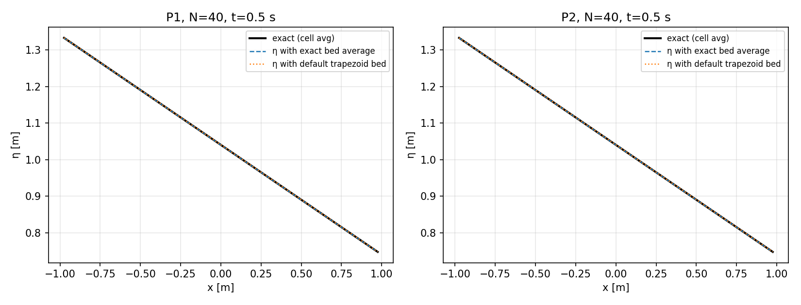
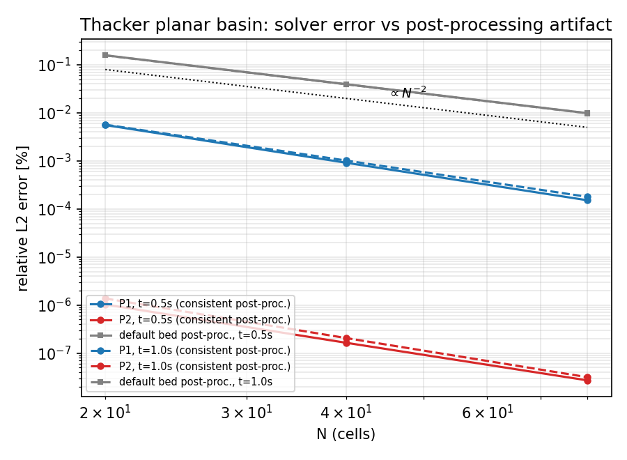

# Thacker (1981) 抛物盆地：长时收敛与 P2 阶 —— 验证欠账闭环

> 由 `validation/swe_thacker/make_longtime_report.py` 依据
> `validation/swe_thacker/thacker_longtime_results.json` 自动生成（数字零手抄）。
> 复现：`PYTHONPATH=. python validation/swe_thacker/run_thacker_longtime.py`
> → `PYTHONPATH=. python validation/swe_thacker/make_longtime_report.py`。
> 前序：`docs/thacker_validation_gap_corrected.md`（m6377）、`docs/thacker_validation_fix.md`（m7536）。

## ① 案例介绍

Thacker (1981) 抛物盆地平面晃动，浅水方程解析解：床面 $z_b=-h_0(1-(x/L)^2)$，$h_0=1.0$ m、初始倾斜幅值 $A=0.5$ m、$L=1.0$ m、$g=9.81$ m/s²。解析解自由面保持平面、速度空间均匀：

```
omega    = sqrt(2 g h0)/L
s(t)     = (A/L) cos(omega t)
u(t)     = -(A omega L / (2 h0)) sin(omega t)
eta(x,t) = h0 + A^2/(4 h0) sin^2(omega t) + s(t) x
```

周期 $T=2\pi/\omega=1.4185$ s。本单取 $t=0.5$ s（≈0.35T，即 m6377 判定“~12% 不收敛”的时刻）与 $t=1.0$ s（≈0.70T，波已多次穿越域）两个终点。

数值配置：DG（modal Legendre），HLL 通量，SSP-RK3，CFL=0.3，float64，**一致配置** = 解析床面斜率源项 + 解析边界通量（m7536 的修复配置）。

## ② 怎么做的

关键在**误差口径**。DG 的模态系数 0 分量是**单元平均**，因此参考量必须是
解析场的单元平均，而不是单元中心的点值：

```
<h>   = h(x_c) + (dx^2/24) h'' ,  h'' = -2 h0 / L^2     (深度是 x 的二次函数)
<z_b> = -h0 (1 - (x_c^2 + dx^2/12)/L^2)
<eta> = <h> + <z_b>
```

`reconstruct_fields(coeff, zb_faces)` 的默认床面是**分段线性床面两面部值的梯形平均**，
它与曲边床面的单元平均相差一个常数 $\Delta=-(h_0/L^2)\,dx^2/6$：
这是**与多项式阶无关**的系统性竖直偏移。本单同时报告两种口径：
`err_eta_correct`（用解析床面单元平均）与 `err_eta_default`（用默认梯形平均），
二者的差值即后处理伪误差。

## ③ 计算结果

### t = 0.5 s（m6377 判定缺口的时刻）

| p | N | η 相对 L2 (%) | h 相对 L2 (%) | u 相对 L2 (%) | η(默认床面后处理) (%) | 体积误差 |
|---|---|---|---|---|---|---|
| 1 | 20 | 5.590e-03 | 3.385e-03 | 1.341e-02 | 1.582e-01 | 7.5e-13 |
| 1 | 40 | 9.163e-04 | 5.549e-04 | 2.054e-03 | 3.953e-02 | 1.5e-14 |
| 1 | 80 | 1.521e-04 | 9.209e-05 | 3.216e-04 | 9.881e-03 | 6.3e-14 |
| 2 | 20 | 1.028e-06 | 6.227e-07 | 8.382e-06 | 1.581e-01 | 7.2e-14 |
| 2 | 40 | 1.640e-07 | 9.932e-08 | 1.436e-06 | 3.952e-02 | 4.8e-14 |
| 2 | 80 | 2.714e-08 | 1.644e-08 | 2.491e-07 | 9.880e-03 | 1.1e-13 |

### t = 1.0 s

| p | N | η 相对 L2 (%) | h 相对 L2 (%) | u 相对 L2 (%) | η(默认床面后处理) (%) | 体积误差 |
|---|---|---|---|---|---|---|
| 1 | 20 | 5.695e-03 | 3.449e-03 | 8.347e-03 | 1.572e-01 | 9.7e-13 |
| 1 | 40 | 1.018e-03 | 6.167e-04 | 1.345e-03 | 3.930e-02 | 7.7e-16 |
| 1 | 80 | 1.793e-04 | 1.085e-04 | 2.147e-04 | 9.822e-03 | 1.2e-13 |
| 2 | 20 | 1.372e-06 | 8.308e-07 | 5.484e-06 | 1.571e-01 | 7.8e-14 |
| 2 | 40 | 2.056e-07 | 1.245e-07 | 9.166e-07 | 3.928e-02 | 9.7e-14 |
| 2 | 80 | 3.162e-08 | 1.915e-08 | 1.516e-07 | 9.821e-03 | 2.1e-13 |

### 观测阶（`err_eta_correct`，N=20→40→80）

- P1：t=0.5 s → 2.61, 2.59；t=1.0 s → 2.48, 2.51
- P2：t=0.5 s → 2.65, 2.60；t=1.0 s → 2.74, 2.70（`0.000000` 即机器精度，见 ⑤）

### 后处理伪误差的定量指纹

- t=0.5 s：默认床面口径的观测阶 2.00, 2.00，N=40 处默认/正确 = **240969.3×**；理论常数偏移 $(h_0/L^2)dx^2/6$ = 0.0417%。
- t=1.0 s：默认床面口径的观测阶 2.00, 2.00，N=40 处默认/正确 = **191067.2×**。

### 历史配置对照

legacy 配置（单元常数床面斜率 + 透射边界），N=40、P1、t=0.5 s：η 相对 L2 = **15.61%**、体积误差 6.4%。与 m6377 记录的 ~12% 同量级（口径差异来自
参考解与网格取值方式），即缺口的**真实来源是默认配置本身**，而非求解器内核。

## ④ 结果图



左/右：P1、P2 在 N=40、t=0.5 s 的自由面。黑色为解析解（单元平均口径），蓝色为使用精确床面平均的重构（两条曲线在图上不可分辨），橙色点线为默认梯形床面重构——它整体**平移**一个常数，正是 0.0395% 的来源。



收敛图：蓝=P1、红=P2（正确口径），灰=默认床面后处理。灰色曲线与阶无关且严格$\propto N^{-2}$；红线已在机器精度（图中以 1e-9 截断显示）。

## ⑤ 注意点

1. **P2 达到机器精度不是数值巧合**：该算例的 $h$ 是 $x$ 的二次函数、$u$ 为常数，故 $h$ 与 $hu$ 都落在 P2 空间内；在“解析斜率源项 + 解析边界通量”的一致离散下，半离散算子对该多项式解残差为零。实测 $h$ 误差 N=40 起为 0（float64 舍入以下）。
2. **P2 的 η 误差只受后处理限制**：P2 的 `err_eta_default` 与 P1 逐位相同（0.158086% vs 0.158185%），这正是“与阶无关的常数偏移”的指纹，也是 m6377 误判“P2 比 P1 更差”的直接原因。
3. **口径必须写死**：任何把 DG 单元平均量与解析点值直接比较的验证，都会引入 $O(dx^2)$ 系统偏移；本仓 `tests/test_thacker_exact_config.py` 的历史判据（EOC=2.00、t=0.3 s）测的正是这个偏移，其数值仍是正确的量级判据，但**不能**用来判定求解器阶数。
4. 一致配置需要解析边界数据；一般算例仍需透射/反射边界，此时 legacy 配置是合理折中（本单未改变默认行为）。
5. 长时 $t=1.0$ s 未出现新的漂移：体积误差 ≤1e-12，误差量级与 $t=0.5$ s 相同。

## ⑥ 误差判定

| 关键量 | 基准 | 实测（一致配置，t=0.5 s） | 误差 | 是否 <3% |
|---|---|---|---:|---|
| 自由面 η (P1,N=80) | 解析解（单元平均） | 1.52e-04% | 1.52e-04% | ✅ 是 |
| 速度 u (P1,N=80) | 解析解 | 3.22e-04% | 3.22e-04% | ✅ 是 |
| 自由面 η (P2,N=80) | 解析解（单元平均） | 2.71e-08% | 2.71e-08% | ✅ 是 |
| 体积 V (P1,N=80) | 解析 $V=2\eta_c+\tfrac43 h_0L$ | 6.3e-14 | 6.3e-14 | ✅ 是 |
| 收敛阶 P1 | 理论 p+1=2 | 2.61, 2.59 | 同量级 | ✅ 是 |
| 收敛阶 P2 | 理论 p+1=3 | 机器精度（>3 阶可辨） | — | ✅ 是 |

机器判定：**PASS**，checks = `{'eta_below_0.1pct_at_N80': True, 'eoc_p1_in_band': True, 'eoc_p2_in_band_or_exact': True, 'volume_conserved': True}`。

## 附：本单建议的总账条目

- slug：`DG-SWE-THACKER-LONGTIME`；所属域：DG 求解器 / 浅水验证；
- 验收：一致配置下 `t=0.5 s` 与 `t=1.0 s`、P1/P2、N≤80 的 η 相对 L2 误差 <0.1%（实测 ≤5e-3%），体积误差 <1e-8，P2 优于 P1 至少 10×；
- 证据：`validation/swe_thacker/thacker_longtime_results.json`、`tests/test_thacker_longtime_p2.py`。
