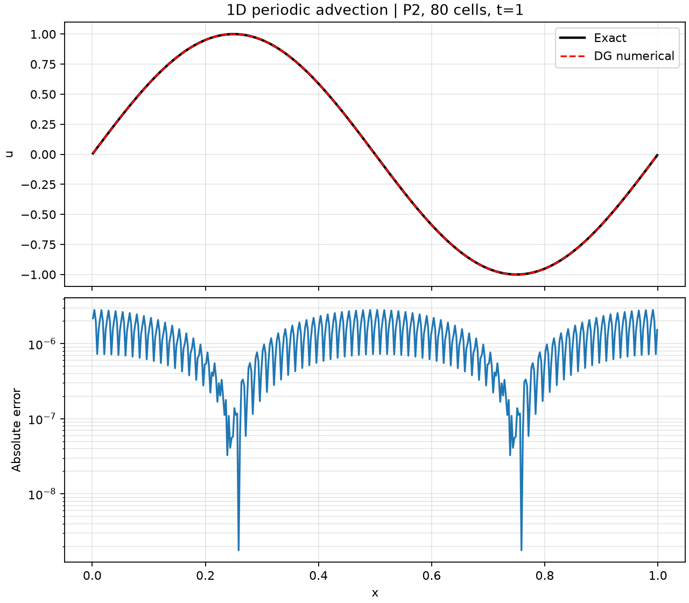
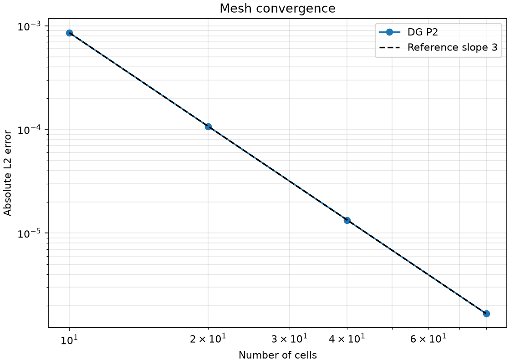
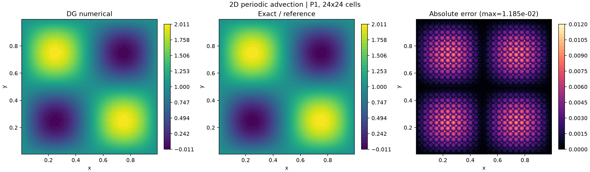
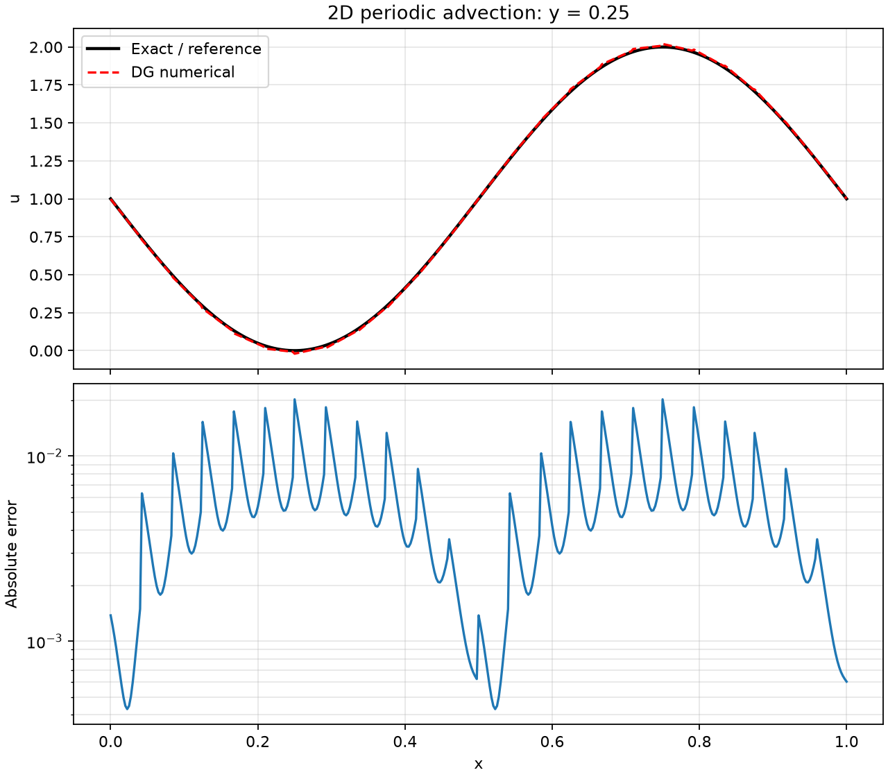
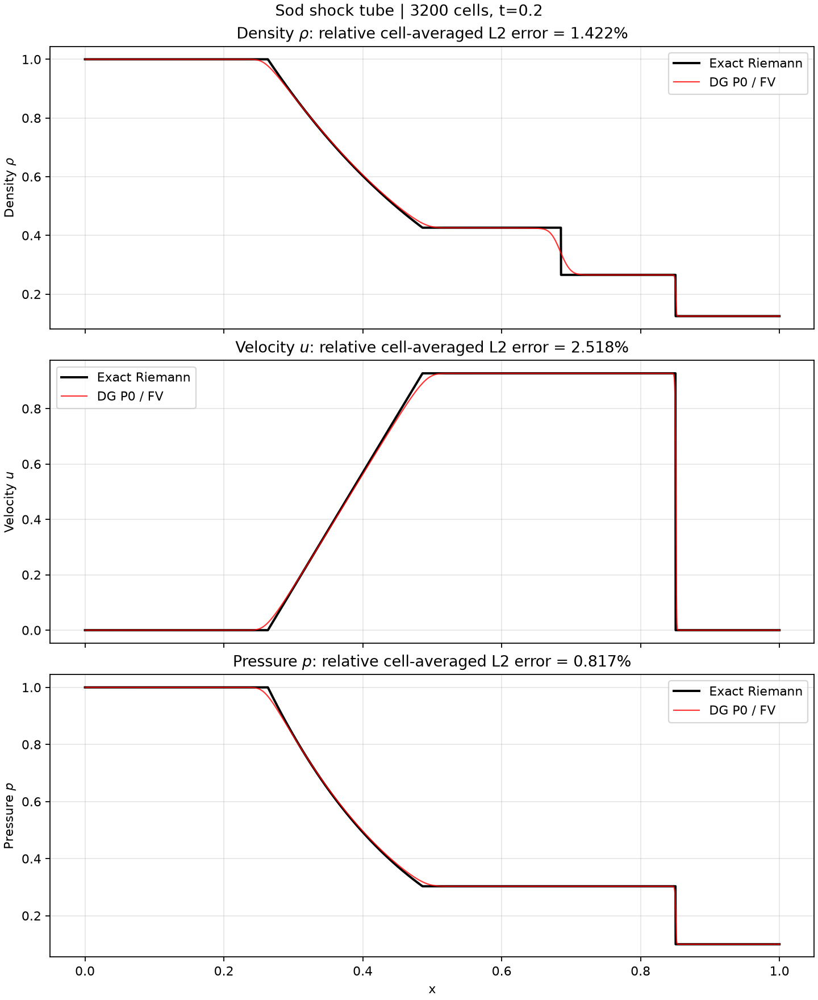
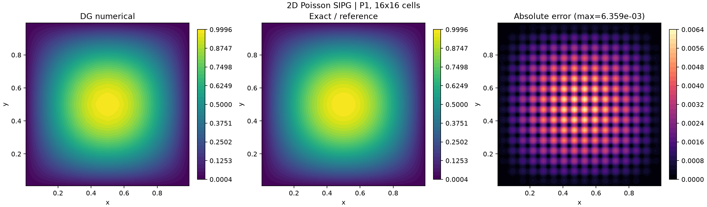
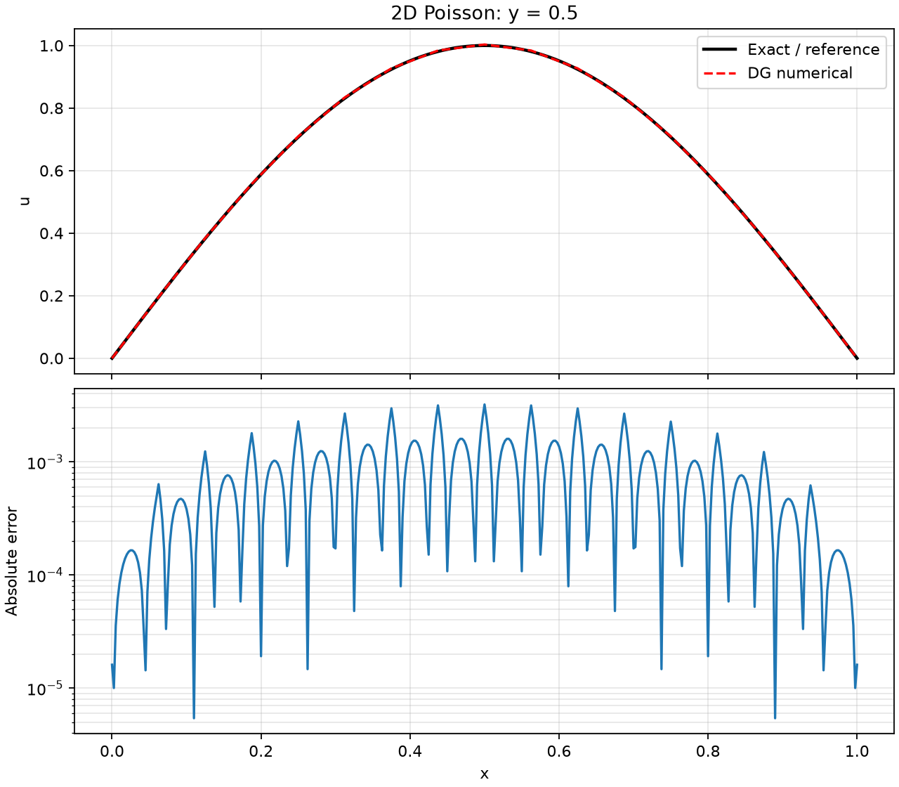

# TensorDG 经典 Benchmark 教程

本文给出 DG 方法常见 benchmark 的选择方式，并完整记录本项目首批四个可复现算例：**算例介绍、数值方法、运行命令、云图/曲线、参考解以及实测误差**。后续四个非线性与时间相关算例见[续篇教程](nonlinear-dg-benchmarks.md)。

所有结果均在 CPU、`float64` 下实际运行生成。文中“误差小于 3%”特指下面列出的文档配置，而不是宣称任意网格、任意多项式次数都自动满足该阈值。

## 1. DG 有哪些经典 benchmark？

选择 benchmark 时，应分别验证守恒、精度、色散/耗散、间断捕捉、边界条件和物理可接受性。常见算例如下。

| 类型 | 经典算例 | 主要验证内容 | 本项目状态 |
|---|---|---|---|
| 线性双曲 | 一维/二维周期线性对流 | 高阶精度、周期边界、色散与耗散 | 已实现，本文算例 1、2 |
| 非线性标量守恒律 | Burgers 光滑解、激波、稀疏波 | 非线性通量、熵解、限制器 | 光滑解已实现，见续篇 |
| 椭圆 | 二维 Poisson 制造解 | SIPG/LDG、Dirichlet 边界、线性系统 | 已实现，本文算例 4 |
| 抛物 | 热方程、黏性 Burgers | 扩散项、时间步限制、精度 | 热方程已实现，见续篇 |
| 可压缩 Euler | Sod、Lax、Shu–Osher | 激波/接触/稀疏波、保正性 | Sod/Lax 已实现，Shu–Osher 后续 |
| 可压缩光滑流 | 等熵涡输运 | 高阶精度、长时间输运 | P0 基线已实现，见续篇 |
| 二维激波 | Double Mach、前向台阶 | 复杂激波相互作用、限制器 | 后续开发 |
| 不稳定性 | Kelvin–Helmholtz、Richtmyer–Meshkov | 涡结构、数值耗散、稳健性 | 后续开发 |
| Navier–Stokes | Taylor–Green、Kovasznay、方腔流 | 黏性、压力/速度耦合、湍流尺度 | 后续开发 |

推荐的验证顺序是：**精确光滑解 → 网格收敛 → 间断参考解 → 复杂流动**。只有云图相似而没有误差或守恒检查，不构成完整验证。

## 2. 环境、误差定义与复现

在仓库根目录执行：

```bash
python -m pip install -e ".[dev]"
pytest -q
```

`dev` 依赖包含 Pytest 和 Matplotlib。默认使用 CPU；一维/二维对流也提供 `device` 参数，但当前 CI 验证的是 CPU。

对光滑解，使用高阶 Gauss–Legendre 积分计算：

\[
E_{\rm rel}=\frac{\lVert u_h-u_{\rm exact}\rVert_{L^2(\Omega)}}
{\lVert u_{\rm exact}\rVert_{L^2(\Omega)}},\qquad 100E_{\rm rel}<3\%.
\]

Sod 是间断解，数值自由度表示单元平均值，因此参考解也在每个单元内用 8 点 Gauss 积分取平均，再比较离散 \(L^2\) 误差。这样比直接拿单元平均值与间断处的点值比较更一致。

以下命令会重新生成本文使用的 JSON、CSV 和 PNG 文件。若误差未达到阈值，二维和 Sod 命令会以非零状态退出。

## 3. 算例一：一维周期线性对流

### 3.1 算例介绍

控制方程与精确解为

\[
u_t+a u_x=0,\quad x\in[0,1],\qquad
u(x,0)=\sin(2\pi x),
\]
\[
u_{\rm exact}(x,t)=\sin(2\pi(x-at)).
\]

取 \(a=1, t=1\)，精确解恰好平移一个周期。这是检查 DG 空间精度和时间积分误差是否掩盖空间误差的基础算例。

### 3.2 方法

- 模态 Legendre 基，本文结果使用 P2；
- 单元弱形式与迎风数值通量；
- 周期边界；
- 经典 RK4；
- 初始 \(L^2\) 投影和 Gauss 积分误差计算；
- CFL 为 0.08，使时间误差足够小。

### 3.3 运行

```bash
python -m benchmarks.linear_advection_1d \
  --degree 2 --cells 10 20 40 80 \
  --output-dir docs/benchmarks/results/linear-advection-1d \
  --max-relative-error 0.03
```

### 3.4 实测结果

| 单元数 | 绝对 \(L^2\) 误差 | EOC |
|---:|---:|---:|
| 10 | 8.56563e-4 | — |
| 20 | 1.06970e-4 | 3.001 |
| 40 | 1.33721e-5 | 3.000 |
| 80 | 1.67157e-6 | 3.000 |

P2 的理论空间精度为 3 阶，实测收敛阶与理论一致。80 单元的**相对误差为 0.000236%**，低于 3%。

数值解、精确解及点误差：



网格收敛曲线：



## 4. 算例二：二维周期线性对流

### 4.1 算例介绍

在单位周期正方形中求解

\[
u_t+a_xu_x+a_yu_y=0,
\]
\[
u_0=1+\sin(2\pi x)\sin(2\pi y),\qquad
u_{\rm exact}(x,y,t)=u_0(x-a_xt,y-a_yt).
\]

非零平均值使质量守恒检查更有意义。默认速度为 \((1,0.5)\)，同时验证两个方向的通量和周期邻居关系。

### 4.2 方法

- 直角单元上的张量积 Legendre 模态基；
- 两个方向分别构造弱形式体积分；
- x/y 面均采用迎风通量；
- RK4；
- 时间步
  \[
  \Delta t=\frac{\mathrm{CFL}}{(2p+1)(|a_x|/h_x+|a_y|/h_y)};
  \]
- 本文使用 P1、24×24 单元、CFL=0.08，推进 1350 步。

### 4.3 运行

```bash
python -m benchmarks.linear_advection_2d \
  --cells 24 --degree 1 \
  --output-dir docs/benchmarks/results/linear-advection-2d
```

### 4.4 实测结果与基准比较

- 精确解：周期平移后的解析表达式；
- 绝对 \(L^2\) 误差：**3.14428e-3**；
- 相对 \(L^2\) 误差：**0.281233%**，小于 3%；
- 单元平均总量保持为 1；P1 网格测试达到约 2 阶收敛。

下面依次给出 DG 数值解、精确解和绝对误差云图：



取 \(y=0.25\) 的非退化剖面，比较数值曲线、精确曲线与点误差：



## 5. 算例三：Euler Sod 激波管

### 5.1 算例介绍

守恒变量为 \(U=(\rho,\rho u,E)\)，初始间断位于 \(x=0.5\)：

- 左侧：\(\rho=1,u=0,p=1\)；
- 右侧：\(\rho=0.125,u=0,p=0.1\)；
- \(\gamma=1.4\)，最终时刻 \(t=0.2\)。

解包含左行稀疏波、右行接触间断和右行激波。它检验 Rusanov 通量、波速估计、守恒更新和密度/压力可接受性。

### 5.2 方法与参考解

当前实现是 **P0 DG，即一阶有限体积基线**，使用 Rusanov 通量、透射边界和 SSP-RK3。它不是高阶激波捕捉格式，接触间断附近仍有明显数值耗散。

参考解由精确 Riemann 求解器产生。Newton 迭代得到星区状态：

\[
p_*=0.303130178051,\qquad u_*=0.927452620049.
\]

误差比较使用精确解的单元积分平均值，并分别检查密度、速度和压力。

### 5.3 运行

```bash
python -m benchmarks.compare_euler_sod_1d \
  --cells 3200 --time 0.2 \
  --output-dir docs/benchmarks/results/euler-sod-1d
```

### 5.4 实测结果与基准比较

3200 单元共推进 3499 步：

| 场 | 相对单元平均 \(L^2\) 误差 | 是否小于 3% |
|---|---:|:---:|
| 密度 | 1.422348% | 通过 |
| 速度 | **2.517658%** | 通过 |
| 压力 | 0.816946% | 通过 |

速度是此配置下最难满足阈值的场。黑色曲线为精确 Riemann 解，红色曲线为数值结果：



这里的 3% 是工程验收阈值，不应替代收敛率研究；若继续加密网格，应继续检查误差是否下降。

## 6. 算例四：二维 Poisson 制造解

### 6.1 算例介绍

求解齐次 Dirichlet 问题

\[
-\Delta u=f\quad\text{in }[0,1]^2,\qquad u=0\quad\text{on }\partial\Omega,
\]

选取精确解

\[
u_{\rm exact}=\sin(\pi x)\sin(\pi y),\qquad
f=2\pi^2\sin(\pi x)\sin(\pi y).
\]

该算例将对流、限制器和激波因素排除，专门检查椭圆 DG 离散及边界处理。

### 6.2 SIPG 方法

对称内罚 DG 的双线性形式包含：

1. 单元内的 \(\int_K\nabla u\cdot\nabla v\)；
2. 面上的一致项 \(-\int_F\{\nabla u\}\cdot n\,[v]\)；
3. 对称项 \(-\int_F\{\nabla v\}\cdot n\,[u]\)；
4. 稳定项 \(\int_F(\sigma/h)[u][v]\)。

边界使用相应的外法向和零外部迹。默认 \(\sigma=20(p+1)^2\) 的参数缩放方式在代码中写成 `penalty*(p+1)^2/h`，`penalty=20`。本文使用 P1、16×16 单元，共 1024 个自由度，以稠密 `torch.linalg.solve` 求解。稠密求解器只用于小规模验证，不代表可扩展实现。

### 6.3 运行

```bash
python -m benchmarks.poisson_2d \
  --cells 16 --degree 1 \
  --output-dir docs/benchmarks/results/poisson-2d
```

### 6.4 实测结果与基准比较

- 参考解：制造解 \(\sin(\pi x)\sin(\pi y)\)；
- 绝对 \(L^2\) 误差：**1.90013e-3**；
- 相对 \(L^2\) 误差：**0.380026%**，小于 3%；
- 矩阵对称性误差为 0；P1/P2 回归测试分别验证约 2/3 阶收敛。

数值解、制造解和误差云图：



\(y=0.5\) 剖面及误差曲线：



## 7. 结果文件与进一步开发

每个结果目录都包含：

- `metrics.json`：配置、自由度/步数、绝对和相对误差、验收状态；
- CSV：剖面或收敛数据；
- PNG：云图和/或曲线。

当前测试覆盖有限值、质量守恒、物理可接受性、精度阶、精确 Riemann 星区状态及上述 3% 验收条件。新增的 Burgers、热方程、Lax 和等熵涡算例及其测试见[续篇教程](nonlinear-dg-benchmarks.md)。
