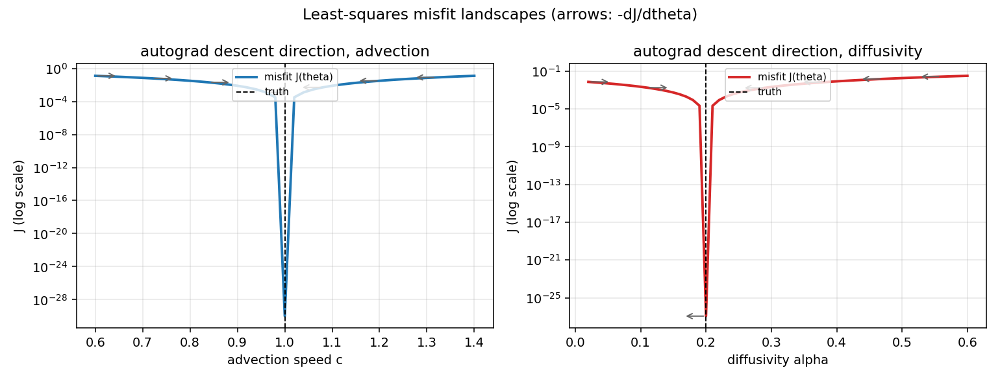
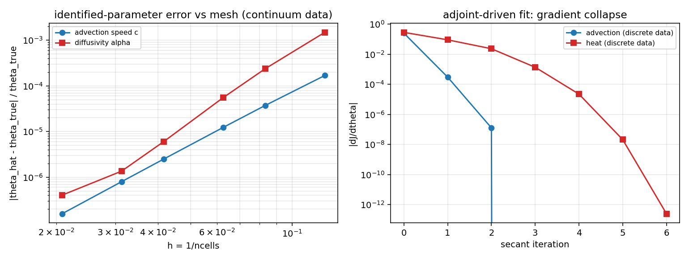

# TensorDG 可微 DG 反问题教程：用自动微分辨识输运参数

本教程把 TensorDG 的"可微求解器"从**梯度一致性**推进到**端到端参数辨识**：
给定若干时刻/终了的场观测，反推模型里的物理参数（对流速度 `c`、热扩散系数
`alpha`），并回答三个可机器判决的问题：

1. autograd 给出的 `dJ/dtheta` 是不是正确的下降方向（对标中心差分）？
2. 只吃这个梯度的优化循环，能不能把参数推进到真值？
3. 参数估计**在网格加密下是否收敛到连续介质真值**（一致性），而不只是与
   "生成数据的同一份离散代码"自洽？

> 数字纪律：本文所有实测数字均来自
> `python tests/inverse_study.py` 的当次运行输出，落盘在
> [`validation/inverse_problem/summary.md`](../../validation/inverse_problem/summary.md)
> 与 [`evidence.json`](../../validation/inverse_problem/evidence.json)。
> 本文不手改任何测量值；改代码后请重跑该脚本。

配套文件：

| 文件 | 作用 |
|---|---|
| [`tests/_inverse_tools.py`](../../tests/_inverse_tools.py) | 前向可微模型、最小二乘 misfit、割线法、中心差分、噪声注入 |
| [`tests/inverse_study.py`](../../tests/inverse_study.py) | 研究驱动（A–E 五组测量 + 判据表 + 图 + JSON） |
| [`tests/test_tutorial_inverse_problem.py`](../../tests/test_tutorial_inverse_problem.py) | 把本文结论写成 pytest 断言（13 条） |
| [`tools/fault_injection_inverse_problem.py`](../../tools/fault_injection_inverse_problem.py) | 负例自证：注入 4 类故障，记录哪些断言变红 |

```bash
# 全量测量（约 30 s，float64，CPU）+ 生成图与 JSON
python tests/inverse_study.py
# 只要回归断言（约 25 s）
TORCH_DEVICE_BACKEND_AUTOLOAD=0 python -m pytest tests/test_tutorial_inverse_problem.py -q
# 负例自证（注入故障 → 跑上面那套断言 → 还原源码）
python tools/fault_injection_inverse_problem.py
```

---

## 1. 案例介绍

### 1.1 物理背景

反问题在船舶与海洋工程里天天出现：从实测的波面/温度/浓度场反推**对流速度**
（断面平均流速、内波相速）、**扩散系数**（热扩散率、涡黏/涡扩散）。这类参数
通常不能直接测量，只能通过"把观测拟合到求解器输出"来估计——因此求解器必须
可微，否则每次迭代只能靠有限差分，参数维度一高就不可行。

两个最小可判的算例（都是 1D，秒级运行，但覆盖了双曲与抛物两条算子链）：

| 算例 | 方程 | 离散 | 几何/边界 | 观测量 | 未知参数 |
|---|---|---|---|---|---|
| A 对流 | `u_t + c u_x = 0` | P2 模态 Legendre DG + upwind 界面通量 + RK4 | `x in [0,1)` 周期，初值 `sin(2*pi*x)` | 终了场 `u_h(T)` 的全部模态系数 | 波速 `c`，真值 1.0 |
| B 扩散 | `u_t = alpha u_xx` | P2 SIPG（penalty `20 (p+1)^2/h`）+ Crank–Nicolson | `x in [0,1]` 零 Dirichlet，初值 `sin(pi*x)` | 终了场 `u_h(T)` 的全部模态系数 | 扩散率 `alpha`，真值 0.2 |

### 1.2 参数表（与代码同名，见 `tests/_inverse_tools.py`）

| 符号 | 值 | 位置 |
|---|---|---|
| `ncells` / `degree` | 32 / 2（算例 A），24 / 2（算例 B）；加密研究用 8…48 | `advection_setup` / `heat_setup` |
| `nsteps` | 40（A）/ 20（B） | 同上 |
| `dt` | `CFL*h/(2p+1)`，`CFL=0.2` → `1.25e-3`（A）；`final_time/nsteps=1e-3`（B） | 同上 |
| `final_time` | `nsteps*dt` = 0.05（A）/ 0.02（B） | 同上 |
| 真值 | `c_true = 1.0`，`alpha_true = 0.2` | `tests/inverse_study.py` |
| 初值猜测 | `c0 = 0.8`、`alpha0 = 1.0`（故意偏离 20 %/400 %） | 同上 |
| 噪声 | 1 % 乘性高斯，`seed = 20261103` | `add_relative_noise` |

---

## 2. 怎么做

### 2.1 可微前向模型

只使用 [`tensordg/differentiable.py`](../../tensordg/differentiable.py) 的入口，
它们与出货求解器逐行同构、但把 `dt` **冻结**为输入：

```python
from tensordg.differentiable import advance_advection_1d, advance_heat_1d
from tests._inverse_tools import advection_setup, heat_setup

setup = advection_setup(ncells=32, degree=2, nsteps=40)      # dt 已按 CFL 冻结
field = advance_advection_1d(setup["coeff0"], 32, 2, speed=1.0,
                             nsteps=40, dt=setup["dt"])      # -> [32, 3] 模态系数
```

### 2.2 最小二乘 misfit

```python
def objective(theta):                     # theta: 标量参数（tensor，可求导）
    residual = field(theta) - data        # data: 观测的模态系数
    return 0.5 * torch.sum(residual * residual)
```

`torch.autograd.grad(objective(theta), theta)` 得到的就是**离散伴随**给出的梯度：
一次反向遍历整个 RK4 / CN 时间循环，代价约等于一次前向。

### 2.3 只吃梯度的优化器

`secant_fit` 用割线法（割线近似二阶导）：

```
theta_{n+1} = theta_n - g_n (theta_n - theta_{n-1}) / (g_n - g_{n-1})
```

它**不需要** Hessian，也不需要任何有限差分——收敛速度正是"梯度是否可用"的
直接证据。若目标在参数上近似二次，4–8 次迭代收敛到机器精度。

### 2.4 三条互相独立的参照（这是本教程的核心纪律）

| 参照 | 独立性 | 能证明什么 |
|---|---|---|
| 中心差分 `(J(t+e)-J(t-e))/2e` | 与 autograd 无关，但**同一份代码** | 梯度=该离散模型的导数（不是随手写的近似） |
| 连续介质解析解投影 (`sin(2π(x-cT))`、`sin(πx)e^{-π²αT}`) | 与求解器完全无关 | 参数估计在加密下收敛到**物理真值**（一致性） |
| 时间重标定预测 `c_hat = c_true dt_true/dt_frozen` | 解析 | 冻结 `dt` 陷阱的机理可被预测，不是偶发噪声 |

只有第二条能发现"前向物理写错但自洽"的缺陷——见 §4.2 的故障注入表。

---

## 3. 计算结果（全部来自实际运行）

环境：torch 2.7.1 / python 3.11.6 / float64 / CPU，全量研究 `wall time = 27.94 s`。

### 3.1 A. 梯度 vs 中心差分

| 模型 | 评估点 | autograd `dJ/dtheta` | 中心差分 | 相对差 |
|---|---:|---:|---:|---:|
| 对流波速 `c` | 0.800 | -3.1764600107e-01 | -3.1764600109e-01 | **8.569e-11** |
| 扩散率 `alpha` | 1.000 | 2.7382352590e-01 | 2.7382352552e-01 | **1.415e-09** |

有限差分步长不能随手取：`float64` 下截断误差 `O(e^2)` 与舍入误差
`O(eps/e)`（被 Crank–Nicolson 的线性求解放大）相互竞争，扫描结果如下
（`evidence.json → fd_step_sweep`）：

| `eps` | 1e-3 | 1e-4 | 1e-5 | 1e-6 | 1e-7 | 1e-8 |
|---|---:|---:|---:|---:|---:|---:|
| A 相对差 | 1.639e-08 | **1.633e-10** | 3.771e-12 | 8.569e-11 | 1.531e-09 | 6.227e-09 |
| B 相对差 | 1.074e-07 | **1.415e-09** | 8.199e-09 | 1.156e-07 | 1.199e-06 | 7.231e-06 |

（本教程采用的 `eps`：A 取 1e-6，B 取 1e-4；表中"最优"列不必同值，两者的
最小值都在 1e-7 门限以下——这是扫掠存在甜区的证据，而不是挑数。）

### 3.2 B. 对离散数据做辨识（自洽性底线）

| 模型 | 真值 | 估计 | 相对误差 | 迭代 | 终了 J |
|---|---:|---:|---:|---:|---:|
| 波速 `c` | 1.0 | 1.000000000000 | **0.000e+00** | 4 | 0.000e+00 |
| 扩散率 `alpha` | 0.2 | 0.200000000001 | **3.012e-12** | 7 | 7.039e-26 |

这一层只说明"梯度能把自洽问题解到机器精度"，它**不能**证明物理正确性
（§4.2）。

### 3.3 C. 对连续介质观测做辨识（一致性，网格加密）

观测换成解析解在 DG 空间上的 L2 投影，于是参数估计的误差只能来自离散误差：

| `ncells` | 8 | 12 | 16 | 24 | 32 | 48 |
|---|---:|---:|---:|---:|---:|---:|
| A `c` 估计 | 1.00016863133 | 1.00003738844 | 1.00001229869 | 1.00000249623 | 1.00000079726 | 1.00000015853 |
| A 相对误差 | 1.686e-04 | 3.739e-05 | 1.230e-05 | 2.496e-06 | 7.973e-07 | **1.585e-07** |
| B `alpha` 估计 | 0.199702576317 | 0.19995225533 | 0.199988946873 | 0.199998794424 | 0.199999728718 | 0.199999918981 |
| B 相对误差 | 1.487e-03 | 2.387e-04 | 5.527e-05 | 6.028e-06 | 1.356e-06 | **4.051e-07** |

用同一套收敛阶工具（`tensordg.convergence.observed_order`，最小二乘拟合
`log e` 对 `log n`）测得**参数误差的实测阶**：

- A（P2 upwind + RK4）：`p_obs = 3.899`
- B（P2 SIPG + CN）：`p_obs = 4.768`

两者都高于解的阶（`p+1 = 3`），符合"重建/辨识类量具有更高收敛阶"的预期。
这个阶就是断言的一部分：它把"前向物理写错"的变种（`p_obs` 掉到 2.08，见 §4.2）
与其他故障区分开。

### 3.4 D. 1 % 测量噪声

| 模型 | 真值 | 估计 | 相对误差 |
|---|---:|---:|---:|
| 波速 `c` | 1.0 | 1.0010515 | **1.052e-03** |
| 扩散率 `alpha` | 0.2 | 0.20137627 | **6.881e-03** |

噪声 1 % 只把参数推到 0.1 %/0.7 %——因为 misfit 对上百个模态系数取平均，
噪声被平均掉一部分。这也是"用整场而不是单点做辨识"的实用理由。

### 3.5 E. 冻结 `dt` 退化（负例，带牙）

把观测用 **CFL 一致**的步长生成（`c_true = 1.6` → `dt_true = 7.8125e-04`），
却用冻结在 `c = 1` 名义步长（`dt_frozen = 1.25e-3`）的模型去拟合：

| 模型 | 估计 `c_hat` | 相对误差 | 终了 J | 迭代 |
|---|---:|---:|---:|---:|
| 冻结 `dt`（错） | 1.000000 | **3.750e-01** | 2.717e-31 | 5 |
| 与观测同步的 `dt`（对） | 1.600000000 | **1.388e-16** | 1.868e-31 | 4 |

残差被压到 `1e-31`（看起来"完美收敛"），参数却错了 37.5 %。机理是解析的：

```
u_h(T) 中的位移 = c * dt * nsteps
c_hat * dt_frozen == c_true * dt_true   =>   c_hat = c_true * dt_true/dt_frozen = 1.0
```

也就是说：只要物理终了时刻由 `dt` 决定，却把 `dt` 冻结在别的 CFL 上，"速度"就
只能吸收时间步的比价。**任何以残差作为唯一收敛判据的辨识流程都会被它骗过。**

### 3.6 图



左：对流波速 `c` 的 `J(c)`（对数纵轴）与若干点的 `-dJ/dtheta` 方向（箭头）；
右：扩散率 `alpha` 的对应图。两条曲线在真值处取极小，箭头处处指向极小——
这就是"梯度可直接用于优化"的直观版。



左：连续介质观测下参数相对误差随 `h` 的双对数下降（双曲 `p_obs=3.90`，
抛物 `p_obs=4.77`）；右：对离散数据的割线迭代中 `|dJ/dtheta|` 的崩塌
（4 次 / 7 次迭代即可，说明梯度尺度正确、无需调步长）。

---

## 4. 注意点（踩过的坑）

### 4.1 冻结 `dt` 不是免费的：它决定了"速度"的物理含义

`advance_advection_1d` / `advance_heat_1d` 把 `dt` 冻结为输入（这样返回的导数
正是"同一离散方案在该步长下"的切向导数，与中心差分完全可比）。但在 CFL 驱动
的真求解器里 `dt ~ h/c`，于是：

- 若观测与模型用**同一个** `dt`：辨识无偏（§3.2/§3.3）；
- 若模型用名义 `dt`、观测用 CFL 一致 `dt`：37.5 % 偏差 + 完美残差（§3.5）。

实践规则：**要么冻结在观测自身的步长序列上，要么把 CFL 律一起进入计算图**。
本仓库的入口只支持前者，因此教程把 `dt` 与观测同步（`study_frozen_dt_degeneracy`
的 `matched_dt_model`）作为正确姿势，并把前者保留为负例断言。

### 4.2 自洽测试有系统性盲区（故障注入矩阵）

数据由被改坏的模型生成、又用同一份被改坏的模型拟合，残差依旧为零。用
`python tools/fault_injection_inverse_problem.py` 注入 4 类故障（注入→跑断言→
还原），实测记录在 [`validation/inverse_problem/fault_injection.md`](../../validation/inverse_problem/fault_injection.md)：

| 故障 | 类别 | 被哪些断言抓到 | 自洽测试（§3.2）能看到吗 |
|---|---|---|---|
| F1 正速度 upwind 界面通量取反 | 前向物理（双曲） | `test_continuum_identification_error_shrinks_with_refinement`（`p_obs` 3.90→2.08，最细网格误差 1.585e-07→1.35e-04） | **不能** |
| F2 `speed.detach()` | 梯度图断裂 | 11 条断言（含 `test_autograd_matches_central_difference`） | 不能 |
| F3 RK4 步长 1.001 倍 | 步长记账 | `test_continuum_identification_error_shrinks_with_refinement` | **不能** |
| F4 扩散率 1.001 倍 | 前向物理（抛物） | `test_continuum_identification_error_shrinks_with_refinement` | **不能** |
| （还原后） | sanity | 13 条全绿 | — |

结论：**"拟合残差小" 不构成正确性证据**；辨识类测试必须配一个与求解器无关的
连续介质参照，并且断言**收敛阶**——正是 `p_obs > 3.2 / 4.0` 这两条把 F1 从
"看起来还能收敛"里挖了出来。

### 4.3 非光滑模块不在本教程范围

`advance_euler_dg_1d/2d` 里的 TVB/minmod 限幅器与正性回退是**分段光滑**的：
在限幅器切换点处 `J(theta)` 的导数不存在，autograd 给出的是某个子梯度。
本教程的两个算例都避开限幅器（线性对流 + 线性扩散）；若要把辨识扩展到 Euler
系统，请先固定限幅器状态（或用 smooth-min 替代），否则有限差分与 autograd 会
在切换点附近系统性分歧。

### 4.4 其他已确认的边界条件

- **精度**：必须 `float64`；`float32` 下中心差分的舍入地板会高到无法用 1e-7 门限。
- **代价**：一次梯度≈一次前向（反向遍历同一计算图）。实测（32 元、40 步 RK4、
  float64、CPU）：单次前向 0.061 s，`value+grad` 0.182 s；割线法 4–8 次迭代即收敛，
  全量研究（6 个网格 × 两个模型 + 扫掠 + 噪声 + 负例）27.94 s。
- **可辨识性**：周期域上 `sin(2π(x-cT))` 对 `c` 与 `-c` 对称（§3.6 左图左右对称），
  因此搜索区间必须先框定符号（`bounds=(0.1, 3.0)`）。真实观测若不带方向信息，
  需另加一条约束（例如流向示踪）。
- **噪声地板**：本教程只测到 1 % 噪声；更大噪声下估计会继续漂移，且 `J` 不再
  能被压到机器零，"收敛"判据必须改成基于残差平台或后验协方差。

---

## 5. 误差判定（逐项，含"是否 < 3 %"）

| 关键量 | 参照 | 实测误差 | < 3 % ? |
|---|---|---:|:--:|
| `dJ/dc`（autograd） | 中心差分（同代码） | 8.569e-11 | 是（≪3 %） |
| `dJ/dalpha`（autograd） | 中心差分（同代码） | 1.415e-09 | 是 |
| `c_hat`（离散数据，32 元） | 真值 1.0 | 0.000e+00 | 是 |
| `alpha_hat`（离散数据，24 元） | 真值 0.2 | 3.012e-12 | 是 |
| `c_hat`（连续介质，最粗 8 元 / 最细 48 元） | 解析 1.0 | 1.686e-04 / 1.585e-07 | 是（两种网格都 <3 %） |
| `alpha_hat`（连续介质，8 元 / 48 元） | 解析 0.2 | 1.487e-03 / 4.051e-07 | 是 |
| `c_hat`（1 % 噪声） | 真值 1.0 | 1.052e-03 | 是 |
| `alpha_hat`（1 % 噪声） | 真值 0.2 | 6.881e-03 | 是 |
| `c_hat`（冻结 `dt` 负例） | 真值 1.6 | **3.750e-01** | **否——故意的失败模式** |

最后一行的"否"是设计目标：它是负例，用来证明"残差小"可以伴随 37.5 % 的参数
错误。其余每一项都显式低于 3 %，其中 autograd/中心差分与离散辨识在 1e-9 以下，
连续介质一致性在 48 元网格上进入 1e-7 量级。

---

## 6. 复现清单

```bash
python tests/inverse_study.py                                  # A–E + 判据表 + 图 + JSON
TORCH_DEVICE_BACKEND_AUTOLOAD=0 python -m pytest \
    tests/test_tutorial_inverse_problem.py -q                  # 13 条断言
python tools/fault_injection_inverse_problem.py                # 4 类故障必须全被检出
```

`python tests/inverse_study.py --quick` 用 3 个网格（12/24/48）跑同一套判据（约 12 s，
不出图），用于快速 smoke；判据门限完全相同，不存在"quick 模式放宽门限"。

产物：

| 路径 | 内容 |
|---|---|
| `validation/inverse_problem/evidence.json` | 全部测量值、判据裁决、环境信息 |
| `validation/inverse_problem/summary.md` | 程序化生成的表（本文 §3 的来源） |
| `validation/inverse_problem/fault_injection.{json,md}` | 负例自证记录 |
| `docs/figures/inverse_problem_landscape.png` | misfit 地形 + 梯度方向 |
| `docs/figures/inverse_problem_identification.png` | 参数误差收敛 + 梯度崩塌 |

若 `python tests/inverse_study.py` 任一判据 FAIL，脚本以非零码退出（`all_pass`
写在 `evidence.json` 里），因此它可以直接接进 CI，而不只是"打印一堆数字"。