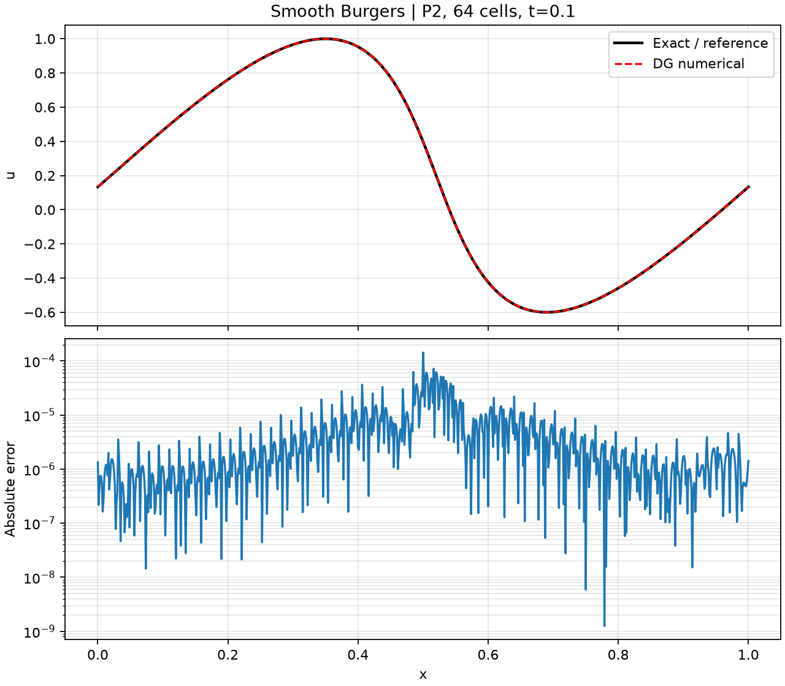
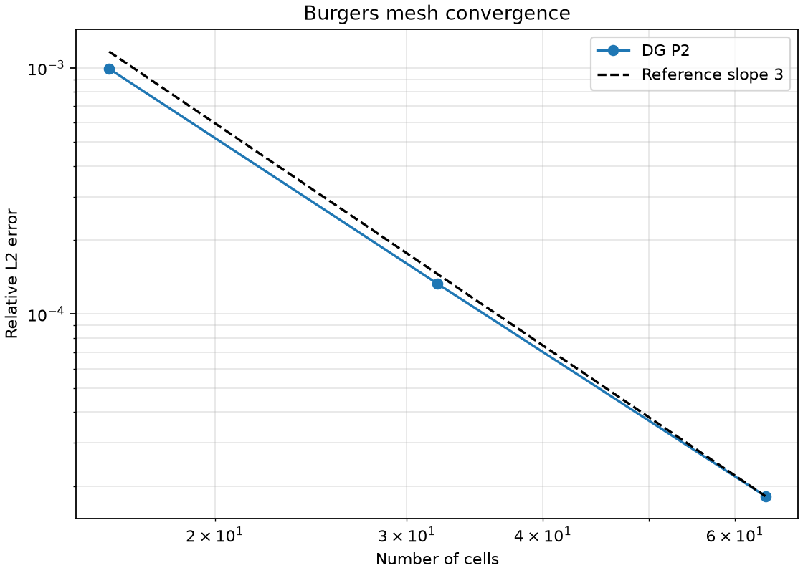
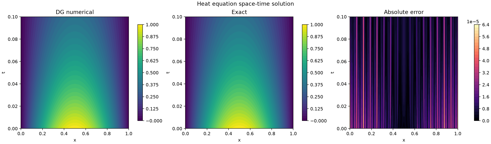
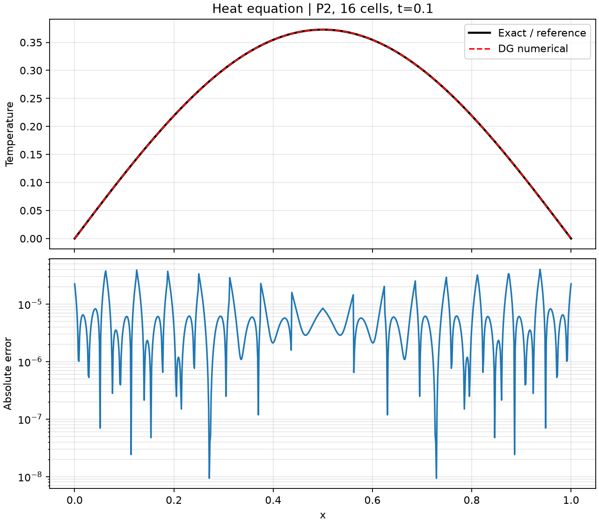
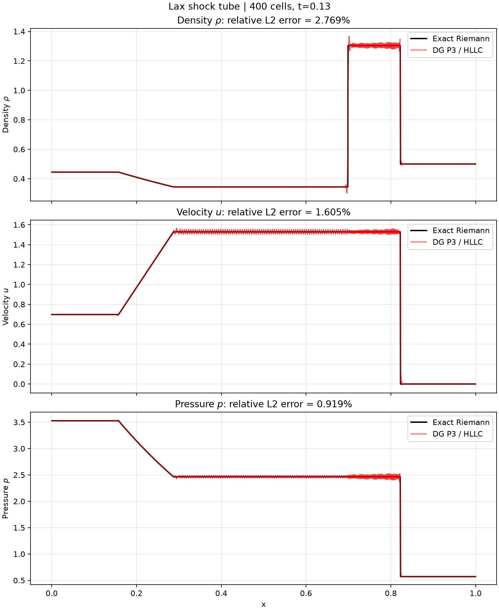
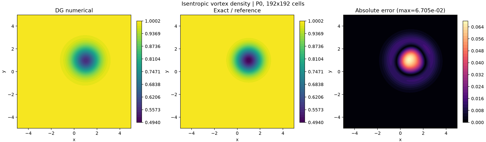
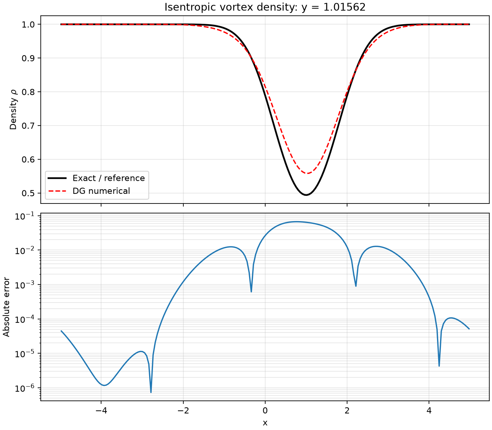

# 非线性与时间相关 DG Benchmark 教程（续篇）

本文接续 [经典 DG Benchmark 教程](classic-dg-benchmarks.md)，新增 **Burgers、热方程、Lax 激波管和二维等熵涡**。每个算例都包含介绍、方法、运行命令、参考解、实测误差以及云图或曲线。

所有结果均由当前代码在 CPU、`float64` 下实际生成。文档配置要求相对 \(L^2\) 误差小于 3%；该结论不自动外推到其他网格、时间或参数。

## 1. 本批算例与验收结果

| 算例 | 方法 | 参考基准 | 最大相对 \(L^2\) 误差 |
|---|---|---|---:|
| Burgers 光滑解 | P2 DG、Rusanov、SSP-RK3 | 特征线隐式精确解 | **0.001820%** |
| 热方程 | P2 SIPG、Crank–Nicolson | 指数衰减正弦解 | **0.003604%** |
| Lax 激波管 | P3 DG、HLLC、局部保正回退 | 一般精确 Riemann 解 | **2.769420%** |
| 二维等熵涡 | P0 DG/有限体积、Rusanov、SSP-RK3 | 移动解析涡 | **1.972990%** |

安装与测试：

```bash
python -m pip install -e ".[dev]"
pytest -q
```

## 2. Burgers：非线性通量与特征线精确解

### 2.1 算例介绍

求解周期单位区间上的无黏 Burgers 方程：

\[
u_t+\left(\frac{u^2}{2}\right)_x=0,\qquad
u_0(x)=0.2+0.8\sin(2\pi x).
\]

取 \(t=0.1\)，仍处于激波形成前的光滑阶段。精确解由特征线隐式给出：

\[
u(x,t)=u_0\bigl(x-u(x,t)t\bigr).
\]

该解通过 Newton 迭代求得。非零平均值 0.2 同时用于检查周期质量守恒。

### 2.2 方法

- P2 模态 Legendre DG；
- Gauss 积分计算非线性体积通量；
- Rusanov 界面通量；
- SSP-RK3 和基于最大 \(|u|\) 的自适应步长；
- 光滑算例不使用限制器，从而可以检查接近三阶的设计精度。

### 2.3 运行

```bash
python -m benchmarks.burgers_1d \
  --cells 16 32 64 --degree 2 \
  --output-dir docs/benchmarks/results/burgers-1d
```

### 2.4 实测结果

| 单元数 | 相对 \(L^2\) 误差 | EOC |
|---:|---:|---:|
| 16 | 0.099242% | — |
| 32 | 0.013301% | 2.899 |
| 64 | **0.001820%** | 2.869 |

数值解、特征线精确解及点误差：



网格收敛曲线：



## 3. 热方程：SIPG 扩散与隐式时间推进

### 3.1 算例介绍

求解

\[
u_t=u_{xx},\qquad u(0,t)=u(1,t)=0,\qquad u(x,0)=\sin(\pi x).
\]

精确解为

\[
u_{\rm exact}(x,t)=\sin(\pi x)e^{-\pi^2t}.
\]

它同时检验扩散刚度矩阵、Dirichlet 边界、质量矩阵和时间阻尼率。

### 3.2 方法

空间上使用 SIPG，得到

\[
M\dot U+AU=0.
\]

Crank–Nicolson 时间离散为

\[
\left(M+\frac{\Delta t}{2}A\right)U^{n+1}
=\left(M-\frac{\Delta t}{2}A\right)U^n.
\]

本文使用 P2、16 单元、80 步，\(\Delta t=0.00125\)。x–t 图中的所有输出时刻共享同一个固定步长，避免独立运行时步数取整造成假象。

### 3.3 运行

```bash
python -m benchmarks.heat_1d \
  --cells 16 --degree 2 \
  --output-dir docs/benchmarks/results/heat-1d
```

### 3.4 实测结果

- 绝对 \(L^2\) 误差：**9.49786e-6**；
- 相对 \(L^2\) 误差：**0.003604%**；
- 扩散矩阵对称性误差为 0；P1 网格测试约二阶收敛。

数值解、精确解和误差的 x–t 云图：



最终时刻剖面：



## 4. Lax 激波管：高阶 Euler DG 与接触间断

### 4.1 算例介绍

标准 Lax 初值为

\[
(\rho,u,p)_L=(0.445,0.698,3.528),\qquad
(\rho,u,p)_R=(0.5,0,0.571),
\]

间断位于 \(x=0.5\)，最终时刻 \(t=0.13\)。一般精确 Riemann 求解器得到

\[
p_*=2.466097919207,\qquad u_*=1.528723026633.
\]

与 Sod 相比，该算例的高密度星区和邻近接触/激波结构对数值耗散更敏感。

### 4.2 方法

- P3 模态 Euler DG 弱形式；
- HLLC 三波通量，显式表示接触波；
- SSP-RK3，CFL=0.35；
- 局部保正回退：只有当单元重构出现非正密度/压力或非有限值时，才退化为单元平均；
- 400 单元，共 5087 步。

**注意：局部保正回退不是 TVD 限制器，也不保证无振荡。** 图中星区的小幅高频成分是真实数值输出，没有用绘图平滑掩盖。更强健的激波捕捉需要后续加入 troubled-cell 检测、TVB/WENO 限制或子单元格式。

### 4.3 运行

```bash
python -m benchmarks.lax_1d \
  --cells 400 --degree 3 --cfl 0.35 \
  --output-dir docs/benchmarks/results/lax-1d
```

### 4.4 实测结果

误差在单元内用 8 点 Gauss 积分，分别对密度、速度和压力计算：

| 场 | 相对 \(L^2\) 误差 | 是否小于 3% |
|---|---:|:---:|
| 密度 | **2.769420%** | 通过 |
| 速度 | 1.605269% | 通过 |
| 压力 | 0.919364% | 通过 |

黑色为精确 Riemann 解，红色为 P3 DG：



## 5. 二维等熵涡：光滑 Euler 输运

### 5.1 算例介绍

在 \([-5,5]^2\) 上计算强度 \(\varepsilon=5\) 的等熵涡，远场 \(\rho_\infty=p_\infty=1\)，背景速度 \((u_\infty,v_\infty)=(1,1)\)。令

\[
r^2=(x-u_\infty t)^2+(y-v_\infty t)^2,\qquad
\chi=\exp\frac{1-r^2}{2},
\]

则

\[
T=1-\frac{(\gamma-1)\varepsilon^2}{8\gamma\pi^2}\chi^2,
\quad \rho=T^{1/(\gamma-1)},\quad p=\rho^\gamma,
\]
\[
u=u_\infty-\frac{\varepsilon}{2\pi}\chi(y-v_\infty t),\qquad
v=v_\infty+\frac{\varepsilon}{2\pi}\chi(x-u_\infty t).
\]

在 \(t=1\) 时涡心移动到 \((1,1)\)，远离周期边界；边界处涡量指数已很小。

### 5.2 方法

当前二维 Euler 基线采用 P0 DG/一阶有限体积、x/y Rusanov 通量和 SSP-RK3。初值和参考解均进行 4×4 单元 Gauss 积分。使用 192×192 单元、CFL=0.4，共 276 步。

该算例验证二维通量、守恒和涡输运，但当前实现不是高阶二维 Euler DG。

### 5.3 运行

```bash
python -m benchmarks.isentropic_vortex_2d \
  --cells 192 \
  --output-dir docs/benchmarks/results/isentropic-vortex-2d
```

### 5.4 实测结果

| 场 | 相对 \(L^2\) 误差 | 是否小于 3% |
|---|---:|:---:|
| 密度 | 0.899439% | 通过 |
| x 速度 | 1.957625% | 通过 |
| y 速度 | **1.972990%** | 通过 |
| 压力 | 1.429768% | 通过 |

密度数值解、解析解和误差云图：



穿过移动涡心的密度剖面：



## 6. 结果文件与后续 benchmark

每个结果目录均包含 `metrics.json`、CSV 和 PNG。测试套件还覆盖 Burgers 质量守恒与收敛、热方程矩阵对称性、Lax 星区状态和保正性，以及等熵涡初始投影与总量守恒。

后续更复杂的 Shu–Osher、Double Mach、Kelvin–Helmholtz 和 Navier–Stokes 算例，需要分别补充高分辨率可信参考、二维激波限制器或黏性/压力求解器，不能直接套用本批的验收配置。
