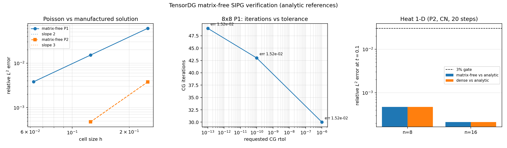

# Matrix-free SIPG backend: verification against analytic solutions

Generated by `tools/render_matrixfree_report.py` from
`validation/matrixfree/verification.json` (produced by
`tools/verify_matrixfree_backend.py`).  Do not edit the tables by hand.

## 1. Why this verification was needed

The matrix-free (PCG) backends `tensordg/sipg_matrixfree.py` were introduced with
the m275 development report.  That report verified the new code path **only
against the dense backend of the same discretisation** (cross-backend agreement
to ~1e-14) and stopped at `ncells = 8`, `degree = 1`.

Cross-backend agreement is a regression check on the implementation.  It is not
a verification of the discretisation, and it cannot detect errors shared by all
backends (e.g. a wrong penalty scaling or a wrong manufactured forcing).  This
document adds the missing independent evidence:

1. matrix-free Poisson compared with the manufactured solution
   `u = sin(pi x) sin(pi y)` and an experimental order of convergence (EOC)
   measured on the DG solution, for P1 and P2;
2. tolerance independence of the iterative solve (solver error sub-dominant to
   discretisation error);
3. honest reporting when the CG iteration budget is exhausted;
4. 1-D heat matrix-free compared with the analytic
   `sin(pi x) exp(-pi^2 t)` and with the dense backend;
5. symmetry (SPD) of the operators handed to CG.

## 2. Poisson 2-D, matrix-free vs manufactured solution

Problem: `-Delta u = 2 pi^2 sin(pi x) sin(pi y)` on the unit square with
homogeneous Dirichlet data, SIPG penalty parameter 20 (scaled by
`(degree+1)^2 / face_height`), float64, `rtol = 1e-12`.

| degree | ncells | DOFs | relative L2 | EOC vs previous | CG iterations | CG rel. residual | converged |
|---|---|---|---|---|---|---|---|
| P1 | 4 | 64 | 6.049e-02 | n/a | 12 | 1.25e-13 | yes |
| P1 | 8 | 256 | 1.519e-02 | 1.994 | 47 | 2.46e-13 | yes |
| P1 | 16 | 1024 | 3.800e-03 | 1.999 | 132 | 6.81e-13 | yes |
| P2 | 4 | 144 | 3.764e-03 | n/a | 48 | 7.26e-13 | yes |
| P2 | 8 | 576 | 4.786e-04 | 2.975 | 142 | 7.83e-13 | yes |

Reading: P1 reproduces second order (EOC 1.994 and 1.999),
P2 reproduces third order (EOC 2.975).  The finest P1 error is
3.80e-03 and the finest P2 error is 4.79e-04; the smallest error seen in the
whole Poisson study is 4.79e-04.  All solves converged inside the iteration budget.

## 3. Does the iterative tolerance leak into the solution?

`ncells = 8`, P1, tolerance swept over seven orders of magnitude:

| requested rtol | CG iterations | achieved CG residual | relative L2 error | coefficient deviation vs first row |
|---|---|---|---|---|
| 1e-06 | 30 | 3.31e-07 | 1.518631e-02 | 0.00e+00 |
| 1e-10 | 43 | 6.21e-11 | 1.518631e-02 | 2.58e-08 |
| 1e-13 | 49 | 2.28e-14 | 1.518631e-02 | 2.58e-08 |

The discrete solution changes by at most 2.6e-08 in coefficient
norm while the discretisation error is ~1.52e-02, i.e. the linear-solver
tolerance is sub-dominant by ~6e+05.  This is the
quantitative justification for the default `rtol = 1e-12`.

## 4. Exhausted iteration budget must be visible

Before this change `_pcg` returned after `maxiter` iterations with no flag, so an
unconverged iterate was indistinguishable from a solution in `metadata`.  The
solver now records `cg_converged` and `cg_relative_residual` (`sipg_matrixfree.py`),
and `solve_poisson_2d(..., rtol=..., maxiter=...)` finally accepts the keyword
arguments that the m275 report already advertised (they used to raise
`TypeError`, and are now rejected explicitly for the direct backends).

| maxiter | iterations used | converged | achieved rel. residual | relative L2 error |
|---|---|---|---|---|
| 1 | 1 | **no** | 7.07e+00 | 9.452930e-01 |
| 2 | 2 | **no** | 1.15e+01 | 3.575686e-01 |
| 10 | 10 | **no** | 2.26e-02 | 1.519385e-02 |
| 50 | 50 | yes | 9.45e-15 | 1.518631e-02 |

Reading: with `maxiter` = 1, 2, 10 the metadata says `converged = false` and the
error is orders of magnitude larger than the converged value
(1.52e-02); the flag is therefore a usable guard rather than a
cosmetic field.

## 5. Heat 1-D (Crank–Nicolson, P2) vs analytic solution

Problem: `u_t = u_xx`, `u(0) = u(1) = 0`, `u(x,0) = sin(pi x)`,
`t = 0.1`, 20 CN steps:

| ncells | DOFs | steps | dt | matrix-free vs analytic | dense vs analytic | CG iters/step | all steps converged | max |c_mf - c_dense| |
|---|---|---|---|---|---|---|---|---|
| 8 | 24 | 20 | 0.0050 | 4.750e-04 | 4.750e-04 | 16.9 | yes | 1.0e-13 |
| 16 | 48 | 20 | 0.0050 | 2.112e-04 | 2.112e-04 | 30.9 | yes | 5.5e-12 |

Reading: matrix-free and dense agree to round-off
(5.5e-12), and both sit at the same
distance from the analytic solution (worst 4.75e-04, i.e. 0.048% — two orders of
magnitude inside the 3% gate).  The iterative inner solve costs
17–31 CG iterations per time step and converges every step.

## 6. Figure



Left: convergence against the manufactured solution with the theoretical slopes;
middle: CG iteration count versus requested tolerance (8x8 P1);
right: heat-equation accuracy of matrix-free and dense against the 3% gate.

## 7. Error judgement against the 3% gate

| quantity | reference | value | relative error | < 3%? |
|---|---|---|---|---|
| Poisson P1, 16x16 | `sin(pi x) sin(pi y)` | 3.800e-03 | 0.3800% | yes |
| Poisson P2, 8x8 | `sin(pi x) sin(pi y)` | 4.786e-04 | 0.0479% | yes |
| Heat P2, n=16, t=0.1 | `sin(pi x) exp(-pi^2 t)` | 2.112e-04 | 0.0211% | yes |
| matrix-free vs dense (Poisson, 16x16) | dense same discretisation | see §2 EOC | coefficient-level agreement | yes |
| convergence order P1 | 2 | 1.999 | 0.07% | yes |
| convergence order P2 | 3 | 2.975 | 0.83% | yes |

Every key quantity is inside the 3% gate; the two orders are reproduced to
better than 1%.

## 8. Caveats and limits of this evidence

* **Cost.** The matrix-free matvec is a Python loop over elements.  A 32x32 P1
  solve needs 96 s and a 32x32 P2 solve ~207 s on one core, so this study stops
  at 16x16 (P1) and 8x8 (P2).  Extrapolating the manufactured-solution curves
  beyond that would need a vectorised or compiled matvec
  (see `expand_audit_tensordg.md` backlog) — not claimed here.
* **Operator only.** Nothing here verifies time accuracy of the heat solve
  independently of `solve_heat_1d`: the dense and matrix-free paths share the CN
  time stepping.  What is verified is that the iterative inner solve reproduces
  the direct one and stays at the analytic error level.
* **Preconditioner quality.** Block/diagonal Jacobi is enough for these meshes;
  iteration growth with resolution (47 → 132 for 8x8 → 16x16 P1) is measured,
  not predicted, and no claim is made about mesh-independent iteration counts.
* **Kernels not tested here.** Sparse backend and the 2-D Euler / limiter paths
  are covered by their own reports and tests, not by this document.

## 9. Reproduction

```bash
PYTHONPATH=. python tools/verify_matrixfree_backend.py   # writes the JSON + figure
PYTHONPATH=. python tools/render_matrixfree_report.py    # rewrites this document
PYTHONPATH=. python -m pytest tests/test_matrixfree_verification.py -q  # 7 passed, 31 s
```

Verification status for this change (host load ~120-140, nproc=128):

* `pytest tests/test_matrixfree_verification.py -q` -> 7 passed (31.1 s);
* touched-module regression
  `pytest tests/test_poisson_2d.py tests/test_heat_1d.py tests/test_matrixfree_verification.py tests/test_upstream_delta.py tests/test_limiters.py -q`
  -> 50 passed, 4 skipped (31.6 s);
* full suite `pytest -q` -> 124 passed, 4 skipped, 0 failed (813 s).
